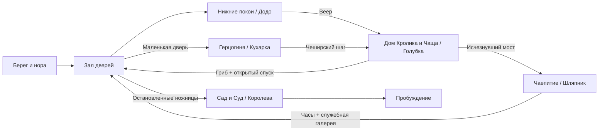

# Alice — Game Design Document

Версия: **0.1**, 31 октября 2026. Язык проекта: русский; идентификаторы в коде: английские.

## 1. Статус документа

Это единый исходный дизайн игры, а не отчёт о реализованных функциях. Изменения обсуждаем и вносим сюда; крупные решения фиксируем в журнале в конце документа.

**Утверждено владельцем:** Unity, 2D, платформер-метроидвания с элементами soulslike; жестокая интерпретация «Алисы в Стране чудес»; основная сюжетная ветка близка к первой книге; пять биомов и пять основных боссов; финальный босс — Королева Червей; 4–5 предметов для открытия путей; бэктрекинг; направляющие персонажи; позднее — 5–6 сквозных побочных заданий.

**Рабочий вариант для проверки:** конкретные четыре способности, Додо / Голубка / Кухарка / Шляпник как первые боссы, устройство мира и суда, оружие, экономика смерти, расположение комнат и параметры боя. Они предложены в этом документе и могут меняться после прототипа.

**Пока не решено:** окончательное название, художественная техника, команда и бюджет, длительность кампании, финальная модель защиты/парирования, коммерческие платформы кроме первоначальной PC-цели.

## 2. Концепция

Алиса следует за Белым Кроликом и оказывается в мире, где абсурдные правила исполняются буквально. Чтобы найти выход, она проходит через затопленные покои, разросшийся лес, владения Герцогини, застывшее чаепитие и королевский сад. В конце пути ей предстоит отвергнуть суд, который решил её судьбу заранее.

Тема: **сначала понять правила, затем использовать их, наконец — решиться их отвергнуть**.

Алиса впервые попадает в этот мир. Её биография и причина происходящего не заимствуются из современных игр об Алисе. Страна чудес обладает собственной жизнью. Насилие связано с властью, страхом, телесными превращениями и бессмысленными процедурами.

### Опоры дизайна

1. **Читаемое действие.** Поражение объясняется поведением противника и решением игрока. Анимации и эффекты сохраняют ясность даже в мрачном окружении.
2. **Способность меняет маршрут.** Каждый предмет открывает обязательный путь и минимум два дополнительных применения в ранее посещённых местах.
3. **Книга узнаётся в событиях.** Дом Кролика, Гусеница, младенец-поросёнок, чаепитие, крокет и суд сохраняют сюжетное значение.
4. **Возвращение показывает последствия.** Остановленная гонка, остывшая кухня и закончившееся чаепитие меняют население и доступные пути.
5. **Жестокость имеет причину.** Окружение показывает, кто вводит правила, кто их выполняет и кто платит за их исполнение.

Первоначальная платформа: Windows PC, клавиатура/мышь и геймпад. Полная переназначаемость и поддержка других платформ планируются после проверки основного управления. Цель производительности — стабильные 60 FPS на будущей согласованной минимальной конфигурации; это пока не измеренное обещание.

## 3. Игровой цикл

Исследование комнаты → столкновение или платформенное препятствие → находка/разговор/короткий путь → точка отдыха → освоение новой возможности → босс или сюжетная перемена → возвращение к замеченному ранее проходу.

На коротком отрезке игрок принимает решения о дистанции, атаке и восстановлении. На уровне биома — выбирает маршрут и момент возвращения к отдыху. На уровне кампании — замечает закрытые проходы и связывает их с новыми предметами.

Первая небольшая версия должна доказать качество движения и боя до производства всех биомов. Пять биомов — рамка кампании, а не требование сразу создавать пять больших уровней.

## 4. Алиса и управление

### Базовые действия

- Бег с контролируемым ускорением и торможением.
- Прыжок с переменной высотой, буфером ввода и небольшим допуском после схода с края.
- Падение со сквозных платформ по отдельной комбинации; не со всех поверхностей.
- Базовая атака на земле и в воздухе; короткое комбо без обязательного сложного ввода.
- Наземное уклонение с настраиваемыми кадрами неуязвимости.
- Взаимодействие, лечение, просмотр карты, выбор и применение предмета.

Воздушный рывок не доступен до веера. Двойного прыжка в базовом наборе нет. Карабканье и захват края не входят в первую итерацию: решение зависит от геометрии прототипа.

### Бой — рабочая модель

Предлагаемое основное оружие — длинная швейная игла с собственной формой и анимацией. Это предмет самообороны и точного укола; окончательный дизайн ещё не утверждён. Не переносим узнаваемое оружие из существующих Alice-игр.

Первая проверяемая модель: атака, уклонение, небольшая шкала выносливости на боевые действия. Бег и обычные прыжки не расходуют её, чтобы исследование не превращалось в ожидание. Воздушный рывок ограничен одним зарядом до приземления.

Парирование проверяется отдельным экспериментом. Если оно становится главным действием, пересматриваем выносливость и телеграфы, а не добавляем вторую полноценную защитную систему автоматически.

У каждого врага: читаемая подготовка, активный удар, восстановление; ясная реакция на попадание; заранее выбранные правила прерывания и неуязвимости. Контактный урон применяется только там, где визуально обоснован, а не ко всем телам по умолчанию.

### Здоровье, отдых и смерть

Рабочий вариант: ограниченное число зарядов лечебного флакона; восстановление на точке отдыха. Точка сохраняет прогресс и возрождает обычных врагов. Боссы, предметы, открытые проходы и завершённые сюжетные события сохраняются.

После смерти Алиса возвращается к последней активированной точке. Потеря переносимой валюты с одной попыткой возврата — гипотеза для прототипа, не утверждённое правило. Сюжетные предметы и способности не теряются. Платформенная ошибка сначала проверяется в более мягкой модели: возврат на безопасную поверхность с ограниченным уроном.

Перед каждым боссом доступна точка отдыха и короткий повторный подход без обязательного повторения длинной платформенной секции. Бесконечные попытки, без расходуемого входного билета.

## 5. Предметы и пространственная прогрессия

Четыре постоянных предмета удовлетворяют требованию 4–5. Пятый добавляем только если он открывает отдельный интересный тип маршрута.

| ID | Предмет | Получение | Возможность | Основной затвор |
| --- | --- | --- | --- | --- |
| A01 | Веер Кролика | После Додо, биом 1 | Короткий горизонтальный рывок в воздухе | Разрыв над Залом дверей к дому Кролика |
| A02 | Кусочек гриба | Гусеница, середина биома 2 | Управляемое уменьшение в отмеченных переходах | Маленькая дверь к служебному входу Герцогини |
| A03 | Чеширский шаг | Кот, после Кухарки, биом 3 | Временно проявлять и пересекать специальные исчезнувшие поверхности | Исчезнувший мост к чаепитию в биоме 2 |
| A04 | Часы отсрочки | После Шляпника, биом 4 | Задерживать обозначенные движущиеся механизмы | Ножницы у старого входа в королевский сад, биом 1 |

### Правила предметов

**Веер:** один рывок до устойчивого приземления; не полёт. Базовое уклонение существует отдельно. Дистанцию фиксируем по результатам тестовой полосы препятствий.

**Гриб:** уменьшение в специально отмеченных местах, отдельные малые маршруты; пока без второго масштаба всей игры и полноценного боя в нём. Возврат только при свободном объёме. На каждом обязательном малом маршруте предусмотрен выход; смерть и перезагрузка восстанавливают корректный размер и позицию. Постановочные превращения пролога не выдаются за постоянную способность.

**Чеширский шаг:** работает с авторскими поверхностями, отмеченными когтями и улыбками. Не позволяет проходить через произвольные стены. При завершении эффекта персонаж возвращается на безопасную опору либо получает достаточно времени на выход; исчезновение пола под игроком без предупреждения запрещено.

**Часы:** действуют на заранее отмеченные механизмы. Не меняют глобальное время игры, интерфейс и сохранения. Обязательный переход всегда допускает повторное применение после восстановления ресурса. Применение к обычным врагам рассматривается отдельно от перемещения.

### Дополнительные применения при возвращении

| Предмет | Раннее место, которое замечает игрок | Награда/результат |
| --- | --- | --- |
| Веер | Верхние балки Зала дверей; дальний берег Моря слёз | Основной выход; необязательный запас ресурса |
| Гриб | Решётка Мыши в биоме 1; подвал дома Кролика в биоме 2 | Разговор/будущий квест; короткая дорога |
| Шаг | Разорванная галерея Герцогини; исчезнувшая лестница Зала дверей | Тайник и история дома; выход к верхним дверям |
| Часы | Сушильные валы в биоме 1; пресс на кухне в биоме 3 | Старый маршрут с новыми ответвлениями; улучшение |

Ни один дополнительный проход не обязателен для возврата потерянной валюты до получения нужной способности.

## 6. Карта кампании и затворы

Основная цепочка:

`Пролог → Нижние покои → Додо / A01 → Дом Кролика → Гусеница / A02 → Голубка → Зал дверей → Герцогиня → Кухарка / A03 → возврат в Чащу → Чаепитие → Шляпник / A04 → возврат в Нижние покои → Червонный сад → Суд → Королева → Эпилог`.

Зал дверей — центральный географический узел. Сначала доступен нижний ярус, затем верхние балки, малые проходы и служебная галерея. Открытые изнутри двери остаются открытыми.

| Переход | Условие | Защита от обхода основной цепочки |
| --- | --- | --- |
| Биом 1 → 2 | Веер | Разрыв за пределом обычного прыжка; награда Додо находится за ареной |
| Биом 2 → 3 | Гриб и завершение встречи с Голубкой | Спуск из верхнего леса закрыт гнездом; после боя открывается постоянный короткий путь к узлу |
| Биом 3 → 4 | Чеширский шаг | Мост в Чаще существует только на специальных поверхностях |
| Биом 4 → 5 | Часы и приглашение из покоев Герцогини | Механический проход в биоме 1; приглашение даёт сюжетный доступ к гостевой части сада |
| Сад → Суд | Эпизод крокета, встреча с Грифоном и Квази | Кролик объявляет заседание, открывается проход в зал |

Получение гриба до Голубки намеренно: игрок тренирует способность перед боссом. Арена не требует боя в малом размере. Победа открывает физический спуск, поэтому ранний гриб сам по себе не позволяет пропустить босса.

Приглашение Герцогини именное. Служебный путь обходит внешнюю стражу; внутри суматоха подготовки позволяет Алисе попасть на крокет как сопровождающей приглашённой особы. Его роль — обстоятельство сцены, а не универсальный ключ ко всем воротам.

Обязательное возвращение ведёт к новому участку старого биома. После босса открывается петля или лифт; повторять весь пройденный уровень не требуется. Быстрое перемещение между точками отдыха рассматриваем после биома 3; обязательный маршрут сначала проектируется проходимым пешком.

## 7. Основной сюжет

### Пролог: берег и падение

Алиса сидит рядом с сестрой, которая читает книгу. Появляется Белый Кролик с часами. Он замечает Алису и на миг выглядит так, будто узнал её. Она следует за ним в нору.

Во время падения бытовые предметы постепенно сменяются клетками, сломанными часами и судебными бумагами. Один из листов содержит незаметную при первом просмотре строку с именем Алисы. Внизу — зал дверей и вид на сад за маленькой дверцей.

Мотивация: попасть в сад, найти Кролика и дорогу домой. Вводный эпизод короткий; после первого просмотра его можно пропустить.

### B01. Нижние покои

**Образ:** огромная мебель, сырость, затопленные комнаты, механические сушилки. Палитра холодная; тёплый свет сада виден далеко за дверью.

**События:** ключ, бутылочка, пирожок; неконтролируемый рост; слёзы; уменьшение; собственное море. Мышь помогает ориентироваться, но пугается рассказа о кошке Дине. На берегу Додо требует пройти Бег по кругу, чтобы обсохнуть и получить разрешение идти дальше.

Гонка бесконечна: распорядитель переносит финиш, потому что проигравших быть не должно. Изношенные участники обслуживают трассу. Алиса останавливает механизм, нарушая процедуру.

**Босс E-B01: Додо, распорядитель Бега.** Фаза 1 — управляемая им сушильная машина с телеграфами вращения. Фаза 2 — Додо снаружи машины, короткие выпады и попытки снова запустить её. Основной навык игрока — дистанция и окна атаки, ещё без воздушного рывка.

Додо побеждён и жив. Он не понимает, чем заниматься без своей должности. За ареной Алиса находит веер Кролика, который использовался в машине.

**Выход:** возврат по верхним балкам к Залу дверей. Маленькая дверь пока недоступна из-за размера. Кролик принимает Алису за Мэри-Энн и посылает за перчатками.

**После возвращения:** гонка остановлена, берег доступен пешком, Мышь появляется в боковом убежище. Опасные валы остаются в технической части.

### B02. Разросшаяся чаща

**Образ:** аккуратный сад Кролика, поглощаемый огромным лесом; грибы, корни, гнёзда и подвешенные ловушки.

**События:** в доме Кролика Алиса выпивает средство и застревает, вырастая. Билля отправляют в дымоход. Брошенные снаружи камни превращаются в пирожки; один помогает выбраться через подвал. Этот эпизод постановочный и компактный, без симуляции разрушения всего дома.

В лесу Гусеница спрашивает «Кто ты?». Алиса сомневается после всех превращений. Гусеница объясняет гриб и даёт возможность управлять уменьшением. Основной выход закрыт корнями, путь идёт через верхние ветви.

Голубка принимает изменяющую размер Алису за змею. В её гнезде лежат вещи прежних незваных гостей. Она защищает кладку и атакует.

**Босс E-B02: Голубка, хранительница кладки.** Фаза 1 — пикирования с заранее видимой траекторией, удары крылом и безопасные окна после посадки. Фаза 2 — часть ветвей ломается, но устойчивые опоры сохраняются; веер помогает менять позицию. Без мгновенных смертей от случайного сноса с платформы.

После поражения Голубка отступает к яйцу. Алиса уходит; бой не заканчивается обязательным убийством. Открывается спуск к центральному узлу.

Кот предупреждает, что сад принадлежит Королеве, и направляет за приглашением к Герцогине.

**Выход:** малый проход и дверь Зала дверей ведут к служебной части владений Герцогини. Прямой вход в сад остаётся закрыт.

**После возвращения:** через новый спуск можно быстро попасть к Гусенице; мост к чаепитию всё ещё отсутствует, пока не получен Шаг.

### B03. Владения Герцогини

**Образ:** особняк, коптильни, кухни и помещения прислуги. Перечная пыль, звон посуды, трубы, разносящие детский плач.

**События:** Рыба-лакей доставляет приглашение, Лягушка-лакей спорит о праве открыть дверь снаружи. Алиса проходит через служебные помещения. Герцогиня обещает взять её в сад, если она успокоит ребёнка.

Кухарка готовит, бросая посуду в окружающих. Алиса выносит ребёнка, он становится поросёнком; она отпускает его в заросли. Пока её нет, Герцогиню арестовывают после ссоры с Королевой.

Кухарка запирает дом и продолжает готовить приём, который уже не состоится. Приглашение осталось в хозяйских покоях, проход к ним лежит через работающую кухню.

**Босс E-B03: Кухарка.** Фаза 1 — тяжёлые удары, посуда и обозначенные зоны пара. Фаза 2 — переключение печных заслонок и безопасных участков арены. Перечные эффекты не закрывают телеграфы и силуэт Алисы.

Кухарка выведена из боя, но жива; переменных смертности для первой версии сюжета нет. Алиса забирает приглашение. Кот предлагает обходной путь и обучает Чеширскому шагу, направляя к Шляпнику.

**Выход:** служебный лифт сокращает путь к Чаще. Исчезнувший мост теперь доступен.

**После возвращения:** кухня остывает, часть пара исчезает; появляются новые переходы и последствия ареста хозяйки.

### B04. Застывшее чаепитие

**Образ:** один бесконечный стол через сад и мастерские; вечные шесть часов. Разные участки существуют в разном состоянии, от свежего чая до плесени.

**События:** Шляпник обещает показать выход «после следующей чашки». Он поссорился со Временем после выступления у Королевы; чаепитие не заканчивается. Соня во сне проговаривается о часах, которые ещё идут.

Алиса узнаёт, что Шляпник удерживает несколько минут до часа собственной казни. Для работы механизма он забирает время у гостей и прислуги. Завершение чаепития вернёт течение времени, которого он боится.

Алиса запускает часы. Шляпник пытается остановить её.

**Босс E-B04: Шляпник.** Фаза 1 — перестановка мест, ритмичные удары и отложенные атаки с видимым отсчётом. Фаза 2 — высвобождение накопленных секунд, старение частей арены, проходы через проявляемые Шагом поверхности. Не используем случайный откат позиции игрока или его сохранений.

Шляпник переживает бой. Алиса запускает время; Заяц слышит тишину, Соня просыпается. Остаётся возможность поговорить с ними. Алиса получает часы отсрочки.

**Выход:** мастерская соединяется с верхней служебной галереей Нижних покоев. Часы позволяют пройти ножницы у входа в сад.

**После возвращения:** чаепитие окончено, стол больше не перемещается; часть бывших препятствий стала короткими путями.

### B05. Червонный сад и Суд

**Образ:** сад из начала игры; под декоративной симметрией — следы наказаний, крашеные розы и искалеченные животные для крокета. Дальше зверинец и торжественный зал суда.

**События:** Алиса встречает садовников, которые исправляют цвет роз. При появлении Королевы прячет их в цветочных горшках — сознательно нарушает королевский приказ.

На крокете правила меняются по ходу игры, а наказание остаётся одним. Палач занят без остановки, и это ничего не исправляет. Герцогиня появляется под надзором; её разговор показывает, что даже приближённые живут в страхе.

Появляется голова Кота. Пока Король и палач спорят, можно ли её отрубить без тела, Алиса покидает площадку. Она следует за Кроликом-глашатаем, надеясь узнать дорогу на поверхность.

Грифон ведёт её к Черепахе Квази. Разговор о школе и танцах даёт тихую сцену перед финалом. Эти персонажи сохраняют собственный голос и не становятся дополнительными боссами.

Кролик объявляет суд над Валетом за кражу пирожков. Показания Шляпника и Кухарки не устанавливают вину. Алису вызывают следующей. Она обнаруживает свою повестку, составленную ещё до её появления в стране: тот самый лист из падения.

Кролик исполнял приказ привести свидетеля. Его колебания видны раньше, но он не объясняет всю интригу заранее. На суде он продолжает читать, затем умолкает перед требованием Королевы вынести приговор до обсуждения доказательств. За пределами этого суда не вводим тайную систему, объясняющую весь мир.

Алиса отказывается подчиняться.

**Босс E-B05: Королева Червей.** Фаза 1 — приказы и карточные построения; игрок читает форму атаки по построению и жесту. Фаза 2 — Королева вступает в бой лично с тяжёлым оружием. Фаза 3 — зал складывается, как карточный дом; короткие переходы применяют знакомые способности и приводят к последнему окну атаки. Переходы не требуют переключать четыре предмета за доли секунды.

Алиса отвергает суд словами о колоде карт. Королева теряет власть над пространством; двор рассыпается. Победа заканчивает игру, без шестого скрытого обязательного босса.

### Эпилог

Алиса просыпается у сестры. На лицо падают листья. Она рассказывает сон, и пережитые сцены звучат почти как детская сказка. Заметив маленькую рану на руке, Алиса замолкает. Камера остаётся на спокойном берегу.

Основная версия имеет одну концовку. Дополнительные концовки не входят в текущий объём. Продолжить исследование после финала можно из сохранения перед судом с явной подсказкой, а не через необъяснимое восстановление уничтоженного двора.

## 8. Направляющие персонажи

| Персонаж | Функция | Что сообщает | Повторная встреча |
| --- | --- | --- | --- |
| Белый Кролик | Сквозная цель и проводник к суду | Срочность, двор, приглашения | Дом, служебные переходы, объявление суда |
| Мышь | Первая ориентация и недоверие | Берег, опасности воды | Убежище в Нижних покоях |
| Додо | Олицетворение процедуры | Условия прохода через берег | После остановки гонки |
| Гусеница | Учитель способности и вопрос идентичности | Гриб и малые проходы | Доступна после открытия спуска |
| Чеширский Кот | Подсказки о связях мира | Герцогиня, Шаг, Шляпник | Чаща, особняк, крокет |
| Герцогиня | Вход в придворный конфликт | Приглашение, положение Королевы | Сад под надзором |
| Соня | Косвенная подсказка | Скрытый механизм времени | После завершения чаепития |
| Грифон и Квази | Передышка и память о стране | Путь к суду, школьное прошлое | Зверинец до финала |

Подсказки имеют три слоя: образная первая реплика, более конкретное повторное уточнение, запись в журнале. Журнал фиксирует намерение Алисы и ориентир, не раскрывая всю карту. Обязательная информация не теряется после одного разговора.

## 9. Обычные враги

Стартовый бюджет кампании: **10 базовых архетипов**, вариации сначала делаем через параметры и композицию встреч. Это оценка объёма, а не уже созданный контент.

| ID | Архетип | Биом | Поведение и назначение |
| --- | --- | --- | --- |
| EN01 | Промокший лакей | 1 | Медленный выпад, обучает окну после удара |
| EN02 | Сборщик на трассе | 1 | Толчок и короткая погоня; учит сохранять пространство |
| EN03 | Садовый паразит | 2 | Низкий прыжок по видимой дуге, учит работать с вертикалью |
| EN04 | Сторожевая птица | 2 | Подготовленное пикирование с посадкой и уязвимостью |
| EN05 | Корневая ловушка | 2 | Стационарная хватка, заранее видимая зона срабатывания |
| EN06 | Перечный слуга | 3 | Ближний бой и ограниченное облако, учит выходить из зоны |
| EN07 | Кухонный метатель | 3 | Снаряд по прямой, уязвимость во время подготовки |
| EN08 | Заводной официант | 4 | Повторяемая серия с паузой; изменяется механизмом комнаты |
| EN09 | Карточный страж | 3, 5 | Щит и тяжёлый выпад, обход после промаха |
| EN10 | Карточный глашатай | 5 | Усиливает строй; приоритетная цель, эффект явно показан |

Мухи, вода, пар, лезвия, ожившая утварь и часы в первой реализации — опасности окружения или варианты этих архетипов, а не скрытое расширение списка полноценных врагов.

Новые враги сначала представляются по одному на безопасной геометрии. Смешанные группы появляются после освоения поведения. В узком проходе не совмещаем обязательный точный прыжок с невидимой дальней атакой.

## 10. Улучшения, карта и сохранения

Рабочая экономика: одна валюта обычных боёв и отдельные уникальные находки. Постоянные улучшения здоровья, лечения и оружия ограничены; числа определяем после первого босса. Новые пространственные способности не покупаются за фарм.

Карта открывается по комнатам, показывает соединения, точки отдыха, замеченные затворы и отметки игрока. Тип затвора обозначен формой и символом, не только цветом. Секретная комната не раскрывается до обнаружения.

Минимальное состояние сохранения: версия схемы; ID точки отдыха; здоровье/заряды при восстановлении; полученные A01–A04; флаги боссов; постоянные двери и лифты; уникальные находки; состояния NPC/диалогов; раскрытая карта; будущие квестовые флаги. Используем устойчивые ID, не имена объектов или их позиции в списке.

Запись атомарная через временный файл и замену, с резервной копией. Ошибка загрузки не перезаписывает исходное сохранение. Хранение через `Application.persistentDataPath`, вне репозитория. Точки автосохранения: отдых, получение способности, победа над боссом, важный постоянный затвор. Смерть не должна отменять уже записанную способность.

## 11. Побочные задания — зарезервированный объём

План: 5–6 сквозных линий, разработка после фиксации основной цепочки. Их полный сюжет сейчас не утверждён. Возможные участники: Мышь, Билль, освобождённые участники гонки, поросёнок, Соня, карточные садовники.

Каждая линия должна соединять минимум два биома, изменять встречу или окружение и иметь понятную запись текущего состояния. Побочные задания не дают обязательные A01–A04 и не блокируют основную концовку. Не вводим необратимый провал за незаметное пересечение границы комнаты. Точки невозврата обозначаем заранее.

## 12. Визуальное и звуковое направление

2D вид сбоку, ортографическая камера, многослойные планы и свет URP 2D. Выбор между рисованной анимацией, скелетной 2D-анимацией и пиксель-артом остаётся открытым. Pixel Perfect и единицы спрайтов фиксируем только после выбора техники.

Алиса, враги и интерактивные поверхности читаются на фоне. Кровь, пыль и постобработка не скрывают края платформ. Визуальная логика биомов связана с их занятиями: сушить, выращивать, готовить, обслуживать, судить.

Музыка и звуки собственные или с проверенной лицензией. Повторяющиеся мотивы меняются после победы над боссом. Звуковые сигналы механик дублируются визуально. Важные реплики имеют субтитры.

Доступность: размер текста, переназначение ввода, настройка тряски и вспышек, раздельная громкость, возможность удержания вместо частых нажатий. Сложность и помощь в таймингах обсуждаются после прототипа; отсутствие таких функций не объявляем частью художественной идеи заранее.

## 13. Технические принципы

Unity 6000.6.6f1, URP 2D, Input System. `Assets/_Alice` — собственный контент. Сцены создаются через Editor API; GUID и `.meta` хранятся в Git. Технические детали описаны в [TechnicalSetup.md](TechnicalSetup.md).

Первоначально: одна сцена проверки движения, затем отдельный малый вертикальный срез. Потоковую загрузку всей карты, сложную архитектуру сервисов и собственные инструменты диалогов не строим до необходимости. Параметры действий и врагов выносим в данные по мере появления второго реального использования.

В коде разделяем движение, боевую реакцию, постоянные способности, состояние мира, диалоги и сохранения. Предметы открываются по ID, а не наличию конкретного объекта в сцене. Время отсрочки применяется к интерфейсу механизма, а не через глобальный `Time.timeScale`.

## 14. Риски и решения до полного производства

| Риск | Что проверяем | Ограничение первой версии |
| --- | --- | --- |
| Размер Алисы умножает объём уровней | Камера, коллизии, выход из малых проходов | Малые маршруты только в отмеченных переходах |
| Четыре способности перегружают ввод | Геймпад и переключение в опасности | Веер на отдельном контекстном действии; сложные комбинации не требуются |
| Книга линейна, карта требует петель | Понятность целей после каждого босса | Центральный узел и четыре проверяемых затвора |
| Пять уникальных боссов дороги | Полноценный Додо до других четырёх | 2 фазы обычно, 3 только у Королевы |
| Мрачные эффекты мешают платформеру | Читаемость без звука и на тёмном экране | Отдельный проход визуальной проверки телеграфов |
| Сходство с современной Alice-адаптацией | Оружие, дизайн, история и материалы | Собственные добавления и реестр источников |
| Катсцены тормозят производство | Ценность эпизода и время реализации | Игровые сцены/иллюстрированные вставки вместо сложной кинопостановки |

## 15. Критерии готовности дизайна к производству

- Утверждены базовый бой, роль парирования и стоимость действий.
- На тестовом маршруте доказаны четыре разных типа пространственных затворов.
- Нет обязательного прыжка, зависящего от случайной частоты кадров.
- Смерть, загрузка и возврат не оставляют Алису за закрытым затвором или в неверном размере.
- Первый биом с Додо пройден от входа до возврата в узел.
- У каждой новой способности есть безопасное обучение и последующее применение.
- Есть оценка времени производства одного врага, комнаты и босса.
- Подтверждены визуальная техника, целевой объём кампании и минимальные системные требования.

## 16. Журнал решений

| Дата | Решение | Статус |
| --- | --- | --- |
| 2026-10-31 | Unity, 2D; пять биомов/боссов; Королева — финал; сюжет близок к книге | Утверждено владельцем |
| 2026-10-31 | Четыре предмета: веер, гриб, Шаг, часы | Рабочая версия |
| 2026-10-31 | Додо, Голубка, Кухарка, Шляпник — первые четыре босса | Рабочая версия |
| 2026-10-31 | Одна концовка и отложенные 5–6 сайдквестов | Рамка первой версии |
| 2026-10-31 | PC-прототип, URP 2D, единый репозиторий | Технический старт |
