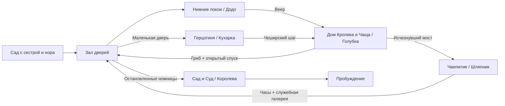

# Alice — Game Design Document

Версия: **0.21**, 4 ноября 2026. Язык проекта: русский; идентификаторы в коде: английские.

## 1. Статус документа

Это исходный дизайн игры, а не отчёт о реализованных функциях. Подробный сюжет и характеры ведём в [Story.md](Story.md); системные и технические предложения — здесь. Крупные решения фиксируем в журнале в конце документа. Текущий этап — M2, боевой эксперимент в Unity (начат 3 ноября 2026 после прототипа движения M1); техническая пауза снята владельцем в редакции 0.13.

Базовая редакция этапа 1 собрана в [сюжетной основе](NarrativeFoundation.md). Этап 2 — [44 эпизода кампании](CampaignEpisodes.md). Этап 3 — [карта мира и помещений](WorldMap.md): 70 рабочих узлов, 24 необязательных, короткие пути, NPC и места для шести будущих квестовых линий. Основу правил действий и боя владелец утвердил в редакции 0.13; численные параметры и геометрию определяют прототипы M1–M2.

**Утверждено владельцем:** Unity, 2D, платформер-метроидвания с элементами soulslike; жестокая интерпретация «Алисы в Стране чудес»; основная сюжетная ветка близка к первой книге; пять биомов и пять основных боссов; финальный босс — Королева Червей; 4–5 предметов для открытия путей; бэктрекинг; направляющие персонажи; позднее — 5–6 сквозных побочных заданий.

**Уточнения истории:** насилие Алисы вынужденное; мир испорчен Королевой — сознательной тираншей; победа освобождает всю страну; Алиса просыпается у сестры, реальность пережитого остаётся загадкой; неизбежная смерть Голубки нужна как тяжёлый эмоциональный эпизод.

**Уточнение концовки:** после речи и начала освобождения страшный зов по имени постепенно превращается в голос сестры. Алиса просыпается в солнечном саду и замечает рядом предмет из страны, о существовании которого не знала. Рабочий вариант — конец ярлыка «Выпей меня» с буквами «ня». Последний крупный план — обрывок, затем сразу титры.

**Уточнения тона:** безопасный, зелёный, солнечный сад у реки резко сменяется мрачным и кровавым кошмаром. Обитатели внешне безобидны и узнаваемы по книге; их жестокость проявляется в поступках. Обычные карточные солдаты могут буднично проводить кровавую казнь. Чудовищные мутации не являются общим художественным направлением.

**Определено для основной версии:** Додо, Голубка, Кухарка, Шляпник и Королева как пять боссов. Додо и Шляпник выживают, когда угроза заканчивается; Голубка и Кухарка погибают в неизбежных столкновениях; Королева — в финальном бою. Различные исходы следуют характеру Алисы, а не правилу обязательного убийства каждого босса.

**Рабочий вариант для проверки:** конкретные четыре способности, постановка встреч и суда, оружие, экономика смерти, расположение комнат и параметры боя. Они предложены в этом документе и могут уточняться при дальнейшем проектировании и прототипировании.

**Уточнения рамки (редакция 0.10):** рейтинг 18+ — осознанная цель, брутальность сохраняется. Языки по умолчанию — русский и английский, локализация закладывается с начала для добавления любых языков. Ориентир масштаба — Blasphemous: компактная, насыщенная кампания без искусственного затягивания. Разработку ведёт один человек с помощью ИИ-агентов.

**Решения редакции 0.13:** техническая пауза снята, начинается M1. Художественная техника — детальный пиксель-арт уровня Blasphemous. Веер срабатывает повторным нажатием прыжка в воздухе. Защита как в Blasphemous: парирование с контратакой и подкат; шкалы выносливости нет. Валюта теряется по классике soulslike. Нужна система пассивных предметов с ограниченными слотами и улучшений.

**Решение редакции 0.14:** масштаб и метрика передвижения утверждены как неизменные. 640×360, 16 пикселей на юнит, тайл — один юнит; пределы прыжка, веера и подката и параметры, от которых они зависят, закреплены константами в коде (раздел 12).

**Решение редакции 0.16:** длина иглы около 2 тайлов; укол достаёт примерно на 2,75 тайла, взмах — на 2 (раздел 4).

**Уточнение редакции 0.17:** Blasphemous — образец того, как выглядит идеальный для владельца пиксель-арт, а не обязательный уровень качества. Планка — детальный пиксель-арт, единый по стилю и палитре, в неизменной метрике раздела 12. Владелец не рисует, поэтому графика не должна требовать ручной дорисовки от него (раздел 12).

**Решения редакции 0.18:** игла — единственное оружие; её прогрессия — приёмы по биомам, заточка, нить в ушке и меняющийся облик (раздел 4). Смерть врага зависит от убивающего удара, открытых врагов можно казнить (раздел 4). Карманы на спрайте Алисы не рисуем: при её масштабе их почти не видно, число карманов показывает меню прогрессии (раздел 10). Модели рабочие, числа — из M2.

**Решение редакции 0.19:** казнь открывает не парирование, а оглушение почти побеждённого врага, и проводить её не обязательно (раздел 4).

**Решения редакции 0.20:** здоровье Алисы — шкала «Ясность ума»; когда она кончается, Алиса теряет сознание и просыпается. Ясность восстанавливает нюхательная соль. Особые приёмы тратят вторую шкалу — «Уверенность», которая медленно копится за победы. Валюта — указы Королевы. Пузырёк «Выпей меня» увеличивает ясность ума, пирожок «Съешь меня» — уверенность (разделы 4 и 10).

**Решение редакции 0.21:** живой враг — препятствие. Пройти сквозь его тело пешком или в прыжке нельзя: его перепрыгивают или проходят подкатом. Касание тела ранит — меньше, чем удар, и не парируется; пока враг оглушён или раскрыт парированием, касание не ранит, чтобы к нему можно было подойти. Если Алиса оказалась внутри тела (приземлилась на врага или подкат кончился под ним), её выталкивает в ближнюю сторону: стоять на врагах нельзя. Насколько удар и касание отбрасывают Алису — свойство врага: тяжёлые отбрасывают дальше. Неуязвимости после попадания у Алисы нет — при шкале ясности каждый удар должен стоить; от урона каждый кадр защищают одиночное попадание каждого удара, отброс и интервал касания у врага.

**Пока не решено:** окончательное название, бюджет, точная длительность кампании, коммерческие платформы кроме первоначальной PC-цели.

## 2. Концепция

Алиса следует за Белым Кроликом и оказывается в Стране чудес, испорченной властью Королевы. Чтобы найти выход, она проходит через затопленные покои, разросшийся лес, владения Герцогини, застывшее чаепитие и королевский сад. Познакомившись с обитателями, она решается защитить их. В финале Алиса отвергает неправый суд и побеждает Королеву, освобождая мир.

Тема: **сначала понять правила, затем использовать их, наконец — решиться их отвергнуть**.

**Отличие от других мрачных адаптаций:** Алиса сама по себе не мрачная и не безумна. Ужас не рождается в её голове — она единственная нормальная в жестоком мире и заложница ситуации. Источник кошмара — поступки обитателей и порядки Королевы.

Алиса впервые попадает в этот мир. Её биография и причина происходящего не заимствуются из современных игр об Алисе. У жителей есть собственная жизнь. Насилие связано с властью, страхом, телесными превращениями и бессмысленными процедурами. Пробуждение в финале сохраняет возможность сна, не отменяя ценность пережитого.

### Опоры дизайна

1. **Читаемое действие.** Поражение объясняется поведением противника и решением игрока. Анимации и эффекты сохраняют ясность даже в мрачном окружении.
2. **Способность меняет маршрут.** Каждый предмет открывает обязательный путь и минимум два дополнительных применения в ранее посещённых местах.
3. **Книга узнаётся в событиях.** Дом Кролика, Гусеница, младенец-поросёнок, чаепитие, крокет и суд сохраняют сюжетное значение.
4. **Возвращение показывает последствия.** Остановленная гонка, остывшая кухня и закончившееся чаепитие меняют население и доступные пути.
5. **Жестокость имеет причину.** Окружение показывает, кто вводит правила, кто их выполняет и кто платит за их исполнение.

Первоначальная платформа: Windows PC, клавиатура/мышь и геймпад. Полная переназначаемость и поддержка других платформ планируются после проверки основного управления. Цель производительности — стабильные 60 FPS на будущей согласованной минимальной конфигурации; это пока не измеренное обещание.

## 3. Игровой цикл

Исследование комнаты → столкновение или платформенное препятствие → находка/разговор/короткий путь → точка отдыха → освоение новой возможности → босс или сюжетная перемена → возвращение к замеченному ранее проходу.

На коротком отрезке игрок принимает решения о дистанции, атаке и восстановлении. На уровне биома — выбирает маршрут и момент возвращения к отдыху. На уровне кампании — замечает закрытые проходы и связывает их с новыми предметами.

Первая небольшая версия должна доказать качество движения и боя до производства всех биомов. Пять биомов — рамка кампании, а не требование сразу создавать пять больших уровней.

## 4. Алиса и управление

### Базовые действия

- Бег с контролируемым ускорением и торможением.
- Прыжок с переменной высотой, буфером ввода и небольшим допуском после схода с края.
- Падение со сквозных платформ по отдельной комбинации; не со всех поверхностей.
- Базовая атака на земле и в воздухе; короткое комбо без обязательного сложного ввода.
- Подкат: низкое быстрое скольжение по земле с кадрами неуязвимости; проходит под высокими ударами и сквозь врагов.
- Парирование отдельной кнопкой с короткой контратакой.
- Взаимодействие, лечение, просмотр карты, применение предмета.

Второго прыжка до веера нет. Веер добавляет ещё один прыжок в воздухе на ту же кнопку: повторное нажатие прыжка после отрыва от земли. Карабканье и захват края не входят в первую итерацию: решение зависит от геометрии прототипа.

### Бой — рабочая модель

Предлагаемое основное оружие — длинная швейная игла с собственной формой и анимацией. Это предмет самообороны и точного укола; длина принята в редакции 0.16, окончательная форма ещё не утверждена. Не переносим узнаваемое оружие из существующих Alice-игр.

**Принято владельцем, редакция 0.16 — длина иглы.** Игла около 2 тайлов (32 пикселя, примерно 70 % роста Алисы): узнаваемая игла, а не копьё. Дальность от центра Алисы: укол — около 2,75 тайла при узкой зоне по высоте, около 0,5 тайла; режущий взмах и атака в воздухе — около 2 тайлов широкой дугой. Укол бьёт далеко, но узко; взмах закрывает слабость против низких и летающих целей, поэтому удар выбирают, а не повторяют один. Дальность укола совпадает с положением Алисы после подката сквозь врага: связка «подкат — разворот — укол» возникает сама. Оружие врагов с древком (алебарды и копья карточных солдат) бьёт дальше, на 3–4 тайла, и к ним подходят через парирование и подкат, а не держат на дистанции. Хитбоксы задаются данными; M2 уточняет дальность в пределах ±0,25 тайла без перерисовки кадров. Улучшения иглы повышают урон и открывают приёмы, но не меняют длину. Для каждого врага дальность его ударов записываем рядом с дальностью Алисы.

**Принято владельцем:** защитная модель как в Blasphemous. Шкалы выносливости нет; темп ограничивают длительность анимаций, восстановление после действия и короткая перезарядка подката. Порыв веера — один до приземления.

**Подкат** — основное уклонение. Он проходит под высокими и горизонтальными ударами и сквозь тело врага, но не спасает от удара по земле и захвата. Кадры неуязвимости короче самого скольжения: проход сквозь атаку остаётся решением по времени, а не постоянной защитой. Пешком тело живого врага не пройти, а касание ранит (редакция 0.21); во время подката касание не считается.

**Парирование** — отдельная кнопка с коротким окном в начале анимации. Удачное парирование отражает удар, открывает врага и даёт контратаку с повышенным уроном; у части обычных врагов она становится добиванием. Неудачное оставляет Алису в восстановлении и открытой для удара. Не всё парируется: захваты, снаряды без отражения, удары по площади и атаки окружения отмечаются отдельным читаемым телеграфом. Боссы получают после парирования окно атаки, а не мгновенную победу.

Ширину окна парирования, длительность подката и урон контратаки определяет прототип M2.

У каждого врага: читаемая подготовка, активный удар, восстановление; ясная реакция на попадание; заранее выбранные правила прерывания и неуязвимости. Контактный урон применяется только там, где визуально обоснован, а не ко всем телам по умолчанию.

### Игла — единственное оружие

**Решение владельца, редакция 0.18.** Игла — единственное оружие Алисы на всю игру; второго оружия и смены оружия нет. Чтобы бой не приедался, игла растёт по четырём направлениям: приёмы, заточка, нить в ушке и облик. Дополнительное разнообразие дадут вспомогательные предметы на действие «применить предмет» — направление рабочее, отдельно не проработано. Узнаваемое оружие из других игр по «Алисе» не используем.

**Приёмы — по одному на биом (рабочая модель).**

| Когда | Приём | Зачем |
| --- | --- | --- |
| Старт | Комбо «укол — взмах», удар в воздухе, парирование с контратакой | Основа этого раздела |
| Биом 1 | Выпад: рывок с уколом на 3–4 тайла | Быстро сократить дистанцию до копейщиков |
| Биом 2 | Удар вниз в прыжке с отскоком от врага | Садовые паразиты и сторожевые птицы |
| Биом 3 | Заряженный укол: удержание кнопки, пробивает щит и проходит сквозь нескольких врагов | Карточные стражи EN09 со щитом |
| Биом 4 | Усиленная контратака: удачное парирование добивает обычного врага | Награда за точную защиту |
| Первый особый приём | Удар с разворота: игла проходит полный круг и бьёт спереди и сзади; тратит уверенность (рабочая цена — 30 из 100) | Окружение и обезглавливание |
| Позже | Заряженный удар в воздухе | Атака сверху |

Мастер продаёт приём, только когда тот появился у него по ходу кампании: фарм ускоряет покупку, но не открывает всё сразу.

Особые приёмы тратят «Уверенность» (раздел «Ясность ума, нюхательная соль и Уверенность» ниже), поэтому их нельзя повторять без конца. Особый приём выбирается на отдыхе, как предмет, и в бою применяется отдельной кнопкой способности; переключать приёмы в бою нельзя (решение владельца, редакция 0.20).

**Заточка** — 4–5 ступеней урона; каждая требует редкого материала с босса или мини-босса.

**Нить в ушке** — одна нить за раз, меняется на отдыхе, отдельно от карманов. Рабочие варианты: красная — кровотечение, золотая — больше валюты, чёрная — длиннее окно парирования, серебряная — урон механизмам и заводным врагам. Вещицы задают сборку Алисы, нить — характер иглы.

**Облик.** Игла рисуется скриптом поверх кадров, поэтому заточка и нить меняют её вид почти без затрат на графику: воронёная сталь, гравировка у ушка, свисающая цветная нить.

### Смерть врагов и казни — рабочая модель

**Задача владельца, редакция 0.18.** Смерть врага зависит от удара, который его убил. Каждое попадание несёт тип удара; в данных врага — набор смертей по типам и обязательная смерть по умолчанию.

| Убивающий удар | Смерть |
| --- | --- |
| Укол | Маленькая рана, кровь вытекает струйкой, враг мучается и затихает |
| Взмах | Рассечение с обильной кровью |
| Удар с разворота | Обезглавливание |
| Прочие | Смерть по умолчанию |

Полный набор получают 3–4 самых частых типа: карточные солдаты, лакеи и подобные. Остальные — смерть по умолчанию и, где позволяет тело, одна-две особые. Боссы погибают в отдельных постановках.

**Казнь** — по образцу Blasphemous (решение редакции 0.19). Казнить можно только оглушённого врага. Оглушение наступает один раз за жизнь врага, когда удар оставляет ему не больше порогового здоровья; порог задан в данных врага, у карточного солдата — 1 из 3. К оглушению может привести любой удар, включая контратаку. Оглушённый враг несколько секунд (солдат — 2,5 с) не действует и подсвечен пульсирующим контуром. Казнь запускает кнопка взаимодействия, а не атака, поэтому выбор за игроком: казнить; добить обычным ударом, и тогда смерть будет по убивающему удару; или упустить момент, и враг придёт в себя. Удачное парирование само казнь не открывает, а даёт контратаку с повышенным уроном. Казнь — короткая постановочная анимация, во время которой Алиса неуязвима. У частых типов казнь своя, у прочих — общая для типа тела. Награда за казнь (валюта, немного здоровья через вещицы) — рабочая, числа из M2. Казни показывают жестокость прямо, как требует рейтинг 18+, оставаясь вынужденным насилием Алисы.

Производство: одна смерть или казнь — анимация из 8 кадров текстовым аниматором PixelLab (около 1 генерации) с общей палитрой крови из скрипта; проба смерти карточного солдата это подтвердила (`Art/Reviews/Alice/Revision04`).

### Здоровье, отдых и смерть

**Принято владельцем:** отдых восстанавливает Алису и сбрасывает обычное состояние мира. Поверженные обычные враги снова находятся на исходных местах, с полным здоровьем и прежним враждебным поведением; повторяемые угрозы и их циклы восстанавливаются. За повторные бои снова выдаётся боевая валюта. Повторные зачистки и фарм разрешены.

Боссы не возвращаются в исходное боевое состояние. Постоянные способности, собранные уникальные предметы, открытые двери, рычаги, лифты, раскрытая карта, ключевые сцены и продвижение NPC/квестов сохраняются. Додо и Шляпник после поражения остаются в новых состояниях; отдых не запускает их бои заново.

В первом отдыхе E04 Алиса видит возвращение поверженного лакея и его повторное нападение. Это наблюдаемая странность страны; её причина пока не объясняется и не связывается с новой магической властью Королевы. Правило не обещает воскрешение Голубки или отмену сюжетных потерь.

### Ясность ума, нюхательная соль и Уверенность

**Решение владельца, редакция 0.20.** Здоровье Алисы — шкала **«Ясность ума»**. Удары врагов отнимают её; урон у каждого удара свой и задан в данных атаки. Когда ясность кончается, Алиса теряет сознание и просыпается у места отдыха — это поражение, описанное ниже.

**Нюхательная соль** восстанавливает ясность. В книге Алиса то и дело вспоминает что-нибудь необычное; здесь она вспоминает, что врачи подносят нюхательную соль к носу, чтобы привести человека в чувство. Зарядов немного, все они возвращаются на отдыхе и после поражения. Применение — короткая анимация на месте с блокировкой движения; удар врага прерывает её, и заряд пропадает. Применение при полной ясности тоже тратит заряд впустую: игра сложная, и каждый промах должен ощущаться. Рабочие числа M2: 2 заряда, каждый возвращает 40 % шкалы, 0,8 с.

**«Уверенность»** — вторая шкала, ресурс особых приёмов иглы. Алиса применяет силу вынужденно, и каждый сильный приём подтачивает её уверенность в том, что она поступает правильно. Уверенность медленно копится, когда Алиса побеждает врагов; казнь даёт больше обычного убийства. Каждый приём тратит свою долю шкалы — это рычаг баланса: чем сильнее приём, тем дороже. Базовые удары, парирование, контратака и казнь уверенность не тратят. Способности перемещения A01–A04 её тоже не тратят, чтобы обязательный путь не зависел от боя. Отдых уверенность не восполняет, поражение не отнимает (подтверждено владельцем).

**Улучшения шкал.** Пузырёк «Выпей меня» увеличивает максимум ясности ума: в книге он уменьшал рост, здесь уменьшает страх, и ясность держится дольше. Пирожок «Съешь меня» увеличивает максимум уверенности: в книге он давал рост, здесь растёт её уверенность. Оба — уникальные находки в мире, их не покупают.

**HUD** — в левом верхнем углу: шкала ясности ума, под ней шкала уверенности и заряды нюхательной соли. Счётчик указов — в противоположном, правом верхнем углу. Текста нет, кроме чисел; значки — пиксель-арт в стиле игры. Текущий HUD — рабочий, весь его ещё предстоит стилизовать.

**Принято владельцем:** поражение выглядит как пробуждение внутри кошмара. Смертельный удар, падение, глухой звук и темнота сменяются резким вдохом в последнем месте отдыха. Алиса помнит боль и столкновение, хотя рана исчезла. Отдых тоже связан с коротким забытьём; поражение возвращает её к нему насильно.

Полного отката времени нет: боссы, ключевые сцены, способности и постоянные изменения сохраняются. До первого отдыха используется начальная площадка у Зала дверей, после — последняя активированная точка. Обязательной сюжетной смерти для знакомства с правилом не требуется. Первое игровое поражение получает более длинную реакцию; дальше переход краткий и не задерживает повторные попытки.

Солнечный сад, лицо сестры и её зов по имени не используются при обычных поражениях. Они принадлежат финальному пробуждению. Причина возвращений не объясняется ни властью Королевы, ни машиной Шляпника; Алиса не может сознательно проснуться домой, выбрав смерть.

**Принято владельцем — потеря валюты по классике soulslike.** При поражении вся переносимая боевая валюта остаётся на месте гибели. Возвращение к этому месту и подбор восстанавливают её полностью. Если Алиса погибает снова, не подобрав её, старая потеря исчезает навсегда, а на новом месте остаётся валюта, заработанная после пробуждения. Одновременно существует только одна потеря.

Если место гибели недостижимо (пропасть, шипы, закрывшаяся арена), валюта остаётся на последней безопасной опоре до гибели. При гибели в бою с боссом она лежит у входа на арену, а не внутри. Отдых не уничтожает потерю. Сюжетные предметы, способности, улучшения и пассивные вещицы не теряются. Платформенная ошибка сначала проверяется в более мягкой модели: возврат на безопасную поверхность с ограниченным уроном.

Перед каждым боссом доступна точка отдыха и короткий повторный подход без обязательного повторения длинной платформенной секции. Бесконечные попытки, без расходуемого входного билета.

## 5. Предметы и пространственная прогрессия

Четыре постоянных предмета удовлетворяют требованию 4–5. Пятый добавляем только если он открывает отдельный интересный тип маршрута.

| ID | Предмет | Получение | Возможность | Основной затвор |
| --- | --- | --- | --- | --- |
| A01 | Веер Кролика | После Додо, биом 1 | Порыв веера — второй прыжок в воздухе на ту же кнопку | Разрыв над Залом дверей к дому Кролика |
| A02 | Кусочек гриба | Гусеница, середина биома 2 | Управляемое уменьшение в отмеченных переходах | Маленькая дверь к служебному входу Герцогини |
| A03 | Чеширский шаг | Кот, после Кухарки, биом 3 | Временно проявлять и пересекать специальные исчезнувшие поверхности | Исчезнувший мост к чаепитию в биоме 2 |
| A04 | Часы отсрочки | После Шляпника, биом 4 | Задерживать обозначенные движущиеся механизмы | Служебные ножницы H04 в узле Зала дверей, у калитки сада |

### Правила предметов

**Веер:** повторное нажатие прыжка в воздухе даёт порыв — ещё один прыжок, один до устойчивого приземления; не полёт. Работает и после обычного прыжка, и после схода с края. Подкат существует отдельно и в воздухе не применяется. Высоту, горизонтальную составляющую и дистанцию фиксируем по результатам тестовой полосы препятствий. Рабочее сюжетное уточнение версии 0.4: первое непроизвольное уменьшение вызывает грибная пыль на веере, которую затем смывает водой. Постоянной функции уменьшения у веера нет; она остаётся за грибом.

**Гриб:** уменьшение в специально отмеченных местах, отдельные малые маршруты; пока без второго масштаба всей игры и полноценного боя в нём. Возврат только при свободном объёме. На каждом обязательном малом маршруте предусмотрен выход; смерть и перезагрузка восстанавливают корректный размер и позицию. Постановочные превращения пролога не выдаются за постоянную способность.

**Чеширский шаг:** работает с авторскими поверхностями, отмеченными когтями и улыбками. Не позволяет проходить через произвольные стены. При завершении эффекта персонаж возвращается на безопасную опору либо получает достаточно времени на выход; исчезновение пола под игроком без предупреждения запрещено.

**Часы:** действуют на заранее отмеченные механизмы. Не меняют глобальное время игры, интерфейс и сохранения. Обязательный переход всегда допускает повторное применение после восстановления ресурса. Применение к обычным врагам рассматривается отдельно от перемещения.

### Дополнительные применения при возвращении

| Предмет | Раннее место, которое замечает игрок | Награда/результат |
| --- | --- | --- |
| Веер | Верхние балки Зала дверей; дальний берег Моря слёз | Основной выход; необязательный запас ресурса |
| Гриб | Щель L09 у берега Мыши; нора W10 под корнями Чащи | Жетоны линии Q01; инструмент Билля Q02 и боковой водосбор |
| Шаг | Забытая вытяжка K10; исчезнувшая дверь H05 в Зале | Верхний тайник K12; первый вход в скрытую область школы |
| Часы | Насосный колодец L11; подчасовой тайник T11 | Боковые находки и улучшения при возвращении |

Ни один дополнительный проход не обязателен для возврата потерянной валюты до получения нужной способности.

## 6. Карта кампании и затворы

Актуальные рисунки и данные помещений находятся в [WorldMap.md](WorldMap.md). Ниже — краткая цепочка кампании. На подробных схемах присутствуют Зал дверей, пять биомов, три скрытых ответвления из нескольких помещений, отдельные тайники, NPC и квестовые места. Масштаб и точные размеры экранов ещё не определены.

Основная цепочка:

`Пролог → Нижние покои → Додо / A01 → Дом Кролика → Гусеница / A02 → Голубка → Зал дверей → Герцогиня → Кухарка / A03 → возврат в Чащу → Чаепитие → Шляпник / A04 → служебная галерея → H04 в Зале дверей → Червонный сад → Суд → Королева → Эпилог`.

Зал дверей — центральный географический узел. Сначала доступен нижний ярус, затем верхние балки, малые проходы и служебная галерея. Открытые изнутри двери остаются открытыми.

| Переход | Условие | Защита от обхода основной цепочки |
| --- | --- | --- |
| Биом 1 → 2 | Веер | Разрыв за пределом обычного прыжка; награда Додо находится за ареной |
| Биом 2 → 3 | Гриб и завершение встречи с Голубкой | Спуск из верхнего леса закрыт гнездом; после боя открывается постоянный короткий путь к узлу |
| Биом 3 → 4 | Чеширский шаг | Мост в Чаще существует только на специальных поверхностях |
| Биом 4 → 5 | Часы и план служебной галереи Шляпника | Ножницы H04 в общем узле Зала дверей; рычаг открывает калитку сада. Это не помещение биома 1 |
| Сад → Суд | Эпизод крокета, встреча с Грифоном и Квази | Кролик объявляет заседание, открывается проход в зал |

Получение гриба до Голубки намеренно: игрок тренирует способность перед боссом. Бой идёт в обычном росте: вытянутую шею Алиса убирает другой стороной гриба в постановочном отступлении до обрушения перехода. Арена не требует ни малого, ни вытянутого тела. Победа открывает физический спуск, поэтому ранний гриб сам по себе не позволяет пропустить босса.

Приглашение Герцогини именное. Служебный путь обходит внешнюю стражу; в саду Алиса встречает садовников и процессию, затем Королева сама велит ей присоединиться к игре. Приглашение не даёт права на свободный проход и не делает Алису сопровождающей арестованной хозяйки.

Обязательное возвращение ведёт к новому участку старого биома. После босса открывается петля или лифт; повторять весь пройденный уровень не требуется. Быстрое перемещение между точками отдыха рассматриваем после биома 3; обязательный маршрут сначала проектируется проходимым пешком.

## 7. Основной сюжет

Подробная актуальная история вынесена в [Story.md](Story.md), версия 0.12. Это источник событий и характеров; настоящая краткая сводка не заменяет синопсис. Правила, характер и мотивы боссов собраны в [сюжетной основе](NarrativeFoundation.md), игровые эпизоды — в [CampaignEpisodes.md](CampaignEpisodes.md). Предыдущая версия с заранее выписанной повесткой и раной после пробуждения снята с рассмотрения.

Королева Червей сознательно испортила страну ради власти. Страх наказания, караулы и исполнители удерживают жителей в мучительных занятиях. Местное волшебство не управляет их волей: Шляпник, например, использует собственное часовое устройство для пленения гостей. Алиса сначала ищет дорогу домой, затем понимает связь между местными бедами и решается защитить тех, с кем познакомилась.

| Часть | Событие и цель | Столкновение и последствие |
| --- | --- | --- |
| Пролог | Сестра, Кролик, падение, маленькая дверь в сад | Неконтролируемые превращения и Море слёз |
| B01. Нижние покои | Мышь; Бег по кругу; попытка вывести участников из машины | Додо выживает, гонка остановлена; найден веер |
| B02. Разросшаяся чаща | Дом Кролика, Билль, Щенок, Гусеница и гриб; дорога через гнездо | Голубка неизбежно погибает, защищаясь и не давая уйти Алисе; открывается спуск |
| B03. Владения Герцогини | Приглашение, ребёнок-поросёнок, арест; клетки и поставки для кухни | Кухарка погибает при нападении на Алису; кухня остановлена, Кот обучает Шагу |
| B04. Чаепитие | Закольцованный стол; Шляпник покупает отсрочку чужим временем | Шляпник выживает, петля прекращается; часы открывают служебный путь в сад |
| B05. Сад и Суд | Садовники, крокет, голова Кота, Грифон и Квази; суд над Валетом | Алиса отказывается от лжесвидетельства; жители начинают помогать друг другу, Королева погибает в последнем бою |
| Развязка и эпилог | Речь Алисы; начало освобождения; страшный зов становится голосом сестры | Пробуждение в саду, находка обрывка «…ня», немедленные титры; природа путешествия не объясняется |

Вынужденное насилие определяет все обязательные бои. Алиса прекращает нападение, когда угроза закончилась. Смерть Голубки как тяжёлый эмоциональный эпизод согласована с владельцем. Исходы Додо, Кухарки и Шляпника выбраны по его поручению. Выживание не снимает с них ответственности, а гибель Кухарки не подаётся как исполненный Алисой приговор.

Поведение персонажей не исправляется автоматически после победы. Жители начинают сопротивляться во время финального боя, затем прекращают исполнение приказов и вместе разоружают тех, кто продолжает расправы. Речь Алисы подчёркивает возможность действовать сообща и память о погибших. Она не занимает трон. Погибшие не воскресают; побочные линии не требуются для основного освобождения мира.

Альтернативные концовки, тайный шестой обязательный босс и моральная шкала сейчас не предусмотрены. Продолжение исследования после финала возможно из явно обозначенного сохранения перед судом.

Обрывок ярлыка заранее показан игроку за спиной Алисы и не попадает в инвентарь. В финале повторяются форма разрыва и бумага. Надпись на ярлыке и обрывке локализуется: в русской версии «Выпей меня» → «ня», в английской «Drink me» → «me». Форма разрыва и прокол одинаковы во всех языках. Зов состоит только из имени «Алиса»; звуковой переход к голосу сестры непрерывен. После находки нет объясняющей реплики или сцены после титров.

Сценарный план включает P01–P02, E01–E39 и R01–R03: два вступления, 39 основных эпизодов и три обязательных возвращения. E35–E36 — части одного боя с Королевой. Возврат после Додо входит в E07. Пять боссов, четыре способности и финал не расширены. Каждый эпизод заканчивается условием перехода и изменением мира; подробная геометрия ещё не определена.

Постановочные детали непрерывны: в R01 берег L02 виден из смотрового окна на площадке выхода лифта W09 в H00; обзор не создаёт проход. Говорящая птица из кухни переживает сцену и освобождается из клетки у K07 в E21. Фрагмент ярлыка виден только в отдельном ракурсе E01 и в финале: в обычной камере H00 он постоянно закрыт каменным цоколем фонового слоя, не помечен как добыча и не исчезает при возвращении.

## 8. Направляющие персонажи

| Персонаж | Функция | Что сообщает | Повторная встреча |
| --- | --- | --- | --- |
| Белый Кролик | Сквозная цель и проводник к суду | Срочность, двор, приглашения | Дом, служебные переходы, объявление суда |
| Мышь | Первая ориентация и недоверие | Берег, опасности воды | Убежище в Нижних покоях |
| Додо | Олицетворение процедуры | Условия прохода через берег | После остановки гонки |
| Гусеница | Учитель способности и вопрос идентичности | Гриб и малые проходы | Доступна после открытия спуска |
| Чеширский Кот | Подсказки о связях мира | Герцогиня, Шаг, Шляпник | Чаща, особняк, крокет |
| Герцогиня | Вход в придворный конфликт | Приглашение, положение Королевы | Сад под надзором |
| Соня | Косвенная подсказка | Скрытый механизм времени | После завершения чаепития |
| Грифон и Квази | Передышка и память о стране | Путь к суду, школьное прошлое | Зверинец до финала |

Подсказки имеют три слоя: образная первая реплика, более конкретное повторное уточнение, запись в журнале. Журнал фиксирует намерение Алисы и ориентир, не раскрывая всю карту. Обязательная информация не теряется после одного разговора.

## 9. Обычные враги

Целевой объём: **10–12 поведенческих архетипов в коде и 25–35 типов врагов** на их основе. В каждом биоме 4–6 собственных типов (облик, атаки, параметры) и 2–3 сквозных, например карточные стражи. Тип врага отличается прежде всего данными и анимацией, а не уникальным кодом. Дополнительно к пяти основным боссам рассматриваются 3–5 мини-боссов или необязательных боссов, привязанных к тайникам и побочным линиям Q01–Q06. Это оценка объёма, а не уже созданный контент.

Ниже — первые 10 архетипов как стартовая основа:

| ID | Архетип | Биом | Поведение и назначение |
| --- | --- | --- | --- |
| EN01 | Промокший лакей | 1 | Медленный выпад, обучает окну после удара |
| EN02 | Сборщик на трассе | 1 | Толчок и короткая погоня; учит сохранять пространство |
| EN03 | Садовый паразит | 2 | Низкий прыжок по видимой дуге, учит работать с вертикалью |
| EN04 | Сторожевая птица | 2 | Подготовленное пикирование с посадкой и уязвимостью |
| EN05 | Корневая ловушка | 2 | Стационарная хватка, заранее видимая зона срабатывания |
| EN06 | Перечный слуга | 3 | Ближний бой и ограниченное облако, учит выходить из зоны |
| EN07 | Кухонный метатель | 3 | Снаряд по прямой, уязвимость во время подготовки |
| EN08 | Заводной официант | 4 | Повторяемая серия с паузой; изменяется механизмом комнаты |
| EN09 | Карточный страж | 3, 5 | Щит и тяжёлый выпад, обход после промаха |
| EN10 | Карточный глашатай | 5 | Усиливает строй; приоритетная цель, эффект явно показан |

Мухи, вода, пар, лезвия, ожившая утварь и часы в первой реализации — опасности окружения или варианты этих архетипов, а не скрытое расширение списка полноценных врагов.

Новые враги сначала представляются по одному на безопасной геометрии. Смешанные группы появляются после освоения поведения. В узком проходе не совмещаем обязательный точный прыжок с невидимой дальней атакой.

## 10. Улучшения, карта и сохранения

**Принятая основа экономики:** обычные бои дают валюту; после отдыха враги возвращаются и повторно дают награду. Игрок вправе фармить ради прокачки. Мирные NPC не входят в этот повторяемый боевой состав и не используются как возобновляемый источник валюты. Тайники, квесты и уникальные находки дополняют боевую экономику.

**Валюта — указы Королевы (решение владельца, редакция 0.20).** Солдаты и слуги подчиняются любому слову из страха, и этот страх записан в приказах. С побеждённых слетают клочки указов с красной печатью-червой. Тратя указы, Алиса уносит страх из Страны чудес. На значке нет читаемого текста.

Параметры цен, наград и улучшений здоровья, лечения и оружия ещё проектируются. A01–A04 получают в основных эпизодах, они не требуют покупки за фарм. Вынужденное насилие определяет мотивы Алисы в сюжетных сценах; оно не вводит моральный запрет или штраф за дополнительные бои игрока.

### Пассивные вещицы и улучшения — рабочая модель

Владелец поставил задачу: нужны предметы, их улучшения и пассивные эффекты, ограниченные количеством. Ниже предложение для проверки; названия и числа рабочие.

**Карманные вещицы** — пассивные предметы, мелочи страны: напёрсток, пуговица, засахаренная конфетка, чайная ложка, игральная карта, ключик от несуществующей двери. Каждая даёт один ясный эффект. Вещицы надеваются только у места отдыха в ограниченное число **карманов фартука**. Старт — 2 кармана, максимум — 6. Обычная вещица занимает один карман, сильная — два. Новые карманы — редкие находки и награды побочных линий. Выбор набора и есть сборка персонажа; переодеться можно на любом отдыхе без штрафа.

**Карманы на спрайте не рисуем (решение владельца, редакция 0.18).** При росте Алисы около 56 пикселей карман на фартуке занял бы 2–3 пикселя и почти не читался бы. Число открытых карманов показывает меню прогрессии на отдыхе.

Объём на кампанию — 20–25 вещиц. Примерно две трети меняют параметры через данные: урон, окно парирования, длительность подката, лечение, получаемую валюту, урон от окружения. Треть меняет поведение: парирование отражает снаряд, подкат оставляет режущий след, после добивания восстанавливается немного здоровья. Вещицы лежат в тайниках, выдаются за побочные линии и мини-боссов, часть продаётся. Ни одна не нужна для прохождения основной ветки и не заменяет A01–A04.

**Улучшения Алисы:**

| Что | Как растёт | Источник |
| --- | --- | --- |
| Максимум ясности ума | Пузырьки «Выпей меня» в тайниках | Исследование, побочные линии |
| Максимум уверенности | Пирожки «Съешь меня» в тайниках | Исследование, побочные линии |
| Заряды нюхательной соли | Уникальные находки | Исследование, боссы |
| Сила нюхательной соли | Ступени улучшения | Валюта у мастера |
| Игла | 4–5 ступеней заточки: урон и облик | Валюта и редкий материал от боссов и мини-боссов |
| Приёмы иглы | По одному на биом: выпад, удар вниз в прыжке, заряженный укол, усиленная контратака, удар с разворота (раздел 4) | Валюта у мастера, по мере появления в продаже |
| Нити | Одна в ушке иглы, меняется на отдыхе | Находки и мастер |
| Карманы | 2 → 6 | Редкие находки, побочные линии |

Основная статья расхода фарма — приёмы и заточка иглы, затем покупка вещиц и сила нюхательной соли. Валюта не покупает A01–A04, карманы, максимумы ясности ума и уверенности и заряды соли: их находят в мире, чтобы исследование оставалось главным источником силы. Кто из обитателей становится мастером и торговцем, решаем вместе с узлом и побочными линиями.

Карта открывается по комнатам, показывает соединения, точки отдыха, замеченные затворы и отметки игрока. Тип затвора обозначен формой и символом, не только цветом. Секретная комната не раскрывается до обнаружения.

Минимальное состояние сохранения: версия схемы; ID точки отдыха; здоровье/заряды при восстановлении; переносимая валюта и единственная потеря (ID комнаты, позиция, сумма); полученные и надетые вещицы, число карманов, улучшения и приёмы; полученные A01–A04; флаги боссов; постоянные двери и лифты; уникальные находки; состояния NPC/диалогов; раскрытая карта; будущие квестовые флаги. Используем устойчивые ID, не имена объектов или их позиции в списке.

Запись атомарная через временный файл и замену, с резервной копией. Ошибка загрузки не перезаписывает исходное сохранение. Хранение через `Application.persistentDataPath`, вне репозитория. Точки автосохранения: отдых, получение способности, победа над боссом, важный постоянный затвор. Смерть не должна отменять уже записанную способность.

## 11. Побочные задания — зарезервированный объём

План: 5–6 сквозных линий, разработка после фиксации основной цепочки. Их полный сюжет сейчас не утверждён. Возможные участники: Мышь, Билль, освобождённые участники гонки, поросёнок, Соня, карточные садовники.

Каждая линия должна соединять минимум два биома, изменять встречу или окружение и иметь понятную запись текущего состояния. Побочные задания не дают обязательные A01–A04 и не блокируют основную концовку. Не вводим необратимый провал за незаметное пересечение границы комнаты. Точки невозврата обозначаем заранее.

## 12. Визуальное и звуковое направление

2D вид сбоку, ортографическая камера, многослойные планы и свет URP 2D.

**Визуальный ориентир Алисы, редакция 0.15:** выбран [второй концепт](../Art/Concepts/Alice/alice-concept-v02.png): естественные пропорции лица, сдержанная мимика, медово-русые волосы с тёмной лентой, приглушённое голубое платье, светлый передник и практичные коричневые ботинки. Красота образа сохраняется без подчёркнутой аниме-стилизации. Возраст — 14–16 лет. Лист служит основой дальнейшей работы; игровой спрайт ещё предстоит адаптировать к росту около 48 пикселей; требования к нему — в [AliceCharacterArt.md](AliceCharacterArt.md). Игла остаётся рабочим вариантом оружия.

**Принято владельцем — детальный пиксель-арт, образец Blasphemous (уточнено в редакции 0.17):** низкое внутреннее разрешение, детализация и покадровая анимация персонажей и боссов, многослойные фоны. Кровь и казни в пикселях читаются жёстко, без фотографического натурализма. Blasphemous — образец, к которому стремимся, а не уровень, без которого графика не принимается. Обязательны единый стиль и палитра, точная сетка, метрика ниже и читаемость. Владелец не рисует: графика делается так, чтобы её не нужно было дорисовывать вручную, — генерацией и программной чисткой или силами нанятого художника. Скелетная анимация во время игры и уменьшение рисунков высокого разрешения не используются для персонажей; спрайты остаются покадровыми, даже если их позы при генерации задаются скелетом.

**Утверждено владельцем, редакция 0.14 — неизменная метрика игры.** Внутреннее разрешение 640×360 с целым масштабированием (×3 до 1920×1080, ×4 до 2560×1440, ×6 до 4K), 16 пикселей на юнит, тайл 16×16 — один юнит, рост Алисы около 48 пикселей (3 тайла). На экране помещается 40×22,5 тайла. Pixel Perfect Camera из URP 2D. Масштаб проверен в серой комнате M1 и больше не меняется.

Все комнаты строятся по пределам передвижения, в целых тайлах:

| Препятствие | Предел |
| --- | --- |
| Уступ, прыжок с места | до 4 тайлов; 5 — недоступно без способности |
| Провал, прыжок с разбега | до 5 тайлов |
| Уступ с порывом веера | до 6 тайлов |
| Провал с порывом веера | до 6 тайлов; 6 — недоступно без веера |
| Проход только подкатом | высота 2 тайла |
| Проход стоя | высота от 3 тайлов |

Эти пределы и параметры, от которых они зависят (скорость бега, высота и время прыжка, ускорение падения, порыв веера, скорость и длительность подката, размеры тела), закреплены в коде константами, а не настройками: изменение любого из них ломает уже построенные комнаты. Тесты проверяют, что параметры соответствуют пределам. Подстраиваются только параметры ощущения, не меняющие досягаемость: разгон и торможение, допуск края, буфер ввода, обрезка прыжка, неуязвимость и перезарядка подката.

Обитатели сохраняют безобидные книжные силуэты. Карта остаётся обычной картой с руками и ногами, Кролик — белым кроликом в жилете, Шляпник — человеком в шляпе. Монструозная анатомия и превращение босса в огромного мутанта не используются как стандартное повышение угрозы. Конкретные дизайны создаём самостоятельно по первоисточнику.

Окружение мрачно; кровь, тела и следы казней показаны прямо. Жестокость часто выполняется буднично, при неизменной внешности и спокойном разговоре. Важна реакция Алисы на то, что остальные считают нормальным. Повествовательный ориентир: обычные карточные солдаты казнят пленного и продолжают обсуждать службу. Солнечное зелёное спокойствие полноценно принадлежит сценам у сестры; передышки внутри страны сохраняют тревогу.

Алиса, враги и интерактивные поверхности читаются на фоне. Кровь, пыль и постобработка не скрывают края платформ. Визуальная логика биомов связана с их занятиями: сушить, выращивать, готовить, обслуживать, судить.

Музыка и звуки собственные или с проверенной лицензией. Повторяющиеся мотивы меняются после победы над боссом. Звуковые сигналы механик дублируются визуально. Важные реплики имеют субтитры.

Рейтинг 18+: кровь, казни и тела показываются прямо. Жестокость сосредоточена в поступках взрослых и их последствиях, а не в смаковании страданий самой Алисы-подростка.

Доступность: размер текста, переназначение ввода, настройка тряски и вспышек, раздельная громкость, возможность удержания вместо частых нажатий. Сложность и помощь в таймингах обсуждаются после прототипа; отсутствие таких функций не объявляем частью художественной идеи заранее.

## 13. Технические принципы

Unity 6000.6.6f1, URP 2D, Input System. `Assets/_Alice` — собственный контент. Сцены создаются через Editor API; GUID и `.meta` хранятся в Git. Технические детали описаны в [TechnicalSetup.md](TechnicalSetup.md).

Первоначально: одна сцена проверки движения, затем отдельный малый вертикальный срез. Потоковую загрузку всей карты, сложную архитектуру сервисов и собственные инструменты диалогов не строим до необходимости. Параметры действий и врагов выносим в данные по мере появления второго реального использования.

В коде разделяем движение, боевую реакцию, постоянные способности, состояние мира, диалоги и сохранения. Предметы открываются по ID, а не наличию конкретного объекта в сцене. Время отсрочки применяется к интерфейсу механизма, а не через глобальный `Time.timeScale`.

Локализация с первого кода: пакет Unity Localization, таблицы строк, никаких строк интерфейса и диалогов в коде и префабах. Языки по умолчанию — русский и английский. Шрифты покрывают кириллицу и латиницу, интерфейс рассчитан на тексты разной длины. Сюжетные реплики получают устойчивые ID; текстуры с надписями (ярлык «Выпей меня», таблички, приказы) — локализуемые ассеты.

Производство рассчитано на одного разработчика с ИИ-агентами: предпочитаем переиспользуемые архетипы и данные уникальному коду, задачи формулируем так, чтобы их можно было делегировать отдельно.

## 14. Риски и решения до полного производства

| Риск | Что проверяем | Ограничение первой версии |
| --- | --- | --- |
| Размер Алисы умножает объём уровней | Камера, коллизии, выход из малых проходов | Малые маршруты только в отмеченных переходах |
| Четыре способности перегружают ввод | Геймпад и переключение в опасности | Веер на повторном нажатии прыжка; сложные комбинации не требуются |
| Книга линейна, карта требует петель | Понятность целей после каждого босса | Центральный узел и четыре проверяемых затвора |
| Пять уникальных боссов дороги | Полноценный Додо до других четырёх | 2 фазы обычно, 3 только у Королевы |
| Мрачные эффекты мешают платформеру | Читаемость без звука и на тёмном экране | Отдельный проход визуальной проверки телеграфов |
| Сходство с современной Alice-адаптацией | Оружие, дизайн, история и материалы | Нормальная Алиса в жестоком мире вместо безумия героини; собственные добавления и реестр источников |
| Объём для одного разработчика | Стоимость врага, комнаты и босса на срезе | Архетипы и варианты через данные; масштаб уровня Blasphemous без искусственного растягивания |
| Катсцены тормозят производство | Ценность эпизода и время реализации | Игровые сцены/иллюстрированные вставки вместо сложной кинопостановки |

## 15. Критерии готовности дизайна к производству

- Параметры подката, парирования и контратаки проверены на прототипе M2.
- На тестовом маршруте доказаны четыре разных типа пространственных затворов.
- Нет обязательного прыжка, зависящего от случайной частоты кадров.
- Смерть, загрузка и возврат не оставляют Алису за закрытым затвором или в неверном размере.
- Первый биом с Додо пройден от входа до возврата в узел.
- У каждой новой способности есть безопасное обучение и последующее применение.
- Есть оценка времени производства одного врага, комнаты и босса.
- Подтверждены масштаб пиксель-арта, целевой объём кампании и минимальные системные требования.

## 16. Журнал решений

| Дата | Решение | Статус |
| --- | --- | --- |
| 2026-10-31 | Unity, 2D; пять биомов/боссов; Королева — финал; сюжет близок к книге | Утверждено владельцем |
| 2026-10-31 | Четыре предмета: веер, гриб, Шаг, часы | Рабочая версия |
| 2026-10-31 | Додо, Голубка, Кухарка, Шляпник — первые четыре босса | Рабочая версия |
| 2026-10-31 | Одна концовка и отложенные 5–6 сайдквестов | Рамка первой версии |
| 2026-10-31 | PC-прототип, URP 2D, единый репозиторий | Технический старт |
| 2026-10-31 | Техническую разработку приостановить; сначала цельная история | Решение владельца |
| 2026-10-31 | Вынужденное насилие; Королева сознательно испортила мир; победа освобождает страну | Утверждено владельцем |
| 2026-10-31 | Пробуждение у сестры; реальность мира остаётся загадкой | Утверждено владельцем |
| 2026-10-31 | Неизбежная смерть Голубки как эмоционально тяжёлый эпизод | Утверждено владельцем |
| 2026-10-31 | Подробный синопсис вести в Story.md; старую ветку с повесткой до падения убрать | Редакция 0.2 |
| 2026-10-31 | После солнечного берега — кровавый мрачный кошмар; безобидная внешность обитателей и ужасные поступки | Утверждено владельцем, редакция 0.3 |
| 2026-11-01 | Алиса — подросток примерно 14–16 лет | Утверждено владельцем |
| 2026-11-01 | Начат этап 1: характер, правила мира, проверка причин событий | Вопрос о способе власти затем закрыт в редакции 0.5 |
| 2026-11-01 | Власть Королевы держится на страхе и силе; волшебная печать убрана | Утверждено владельцем, редакция 0.5 |
| 2026-11-01 | После победы Алиса говорит о погибших и совместном сопротивлении; жители сами прекращают расправы | Смысл утверждён владельцем; текст и постановка рабочие |
| 2026-11-01 | Зов по имени меняется от страшного к голосу сестры; пробуждение в саду; предмет из страны и сразу титры | Утверждено владельцем, редакция 0.6; обрывок ярлыка выбран рабочей деталью |
| 2026-11-01 | Додо и Шляпник выживают после прекращения угрозы; Кухарка погибает, продолжая нападение. Мотивы и последствия разобраны отдельно | Выбрано для основной версии по поручению владельца, редакция 0.7 |
| 2026-11-01 | Кампания разложена на 44 эпизода; зафиксированы переходы, возвраты, состояния ключа и способностей | Этап 2 подготовлен, редакция 0.8; далее проверка на карте |
| 2026-11-01 | Нарисован узел и пять биомов: 70 рабочих помещений, 24 необязательных; зарезервированы тайники, NPC и шесть квестовых линий | Этап 3: схема связей подготовлена, редакция 0.9; масштаб требует дальнейшей проверки |
| 2026-11-01 | Рейтинг 18+, брутальность сохраняется | Утверждено владельцем, редакция 0.10 |
| 2026-11-01 | Алиса не мрачная и не безумная: нормальная девочка, заложница жестокого мира | Утверждено владельцем, редакция 0.10 |
| 2026-11-01 | Русский и английский по умолчанию; локализация закладывается для любых языков | Утверждено владельцем, редакция 0.10 |
| 2026-11-01 | Масштаб на уровне Blasphemous без искусственного затягивания; разработка одним человеком с ИИ-агентами | Утверждено владельцем, редакция 0.10 |
| 2026-11-01 | Враги: 10–12 архетипов, 25–35 типов; 3–5 мини-боссов в дополнение к пяти основным | Рабочая версия, редакция 0.10 |
| 2026-11-01 | Отдых возвращает обычных врагов на прежние места и сбрасывает повторяемые угрозы; боевая валюта и фарм сохраняются. Первый отдых показывает повторное нападение лакея | Утверждено владельцем, редакция 0.10; боссы и постоянный прогресс не сбрасываются |
| 2026-11-01 | Поражение Алисы — пробуждение внутри кошмара в последнем месте отдыха, с памятью о боли. Повторные пробуждения не используют сестру и солнечный сад | Утверждено владельцем, редакция 0.11; основные эпизоды и прогресс не отматываются |
| 2026-11-01 | Исправлены пять расхождений: подвал не является коротким путём; ножницы находятся в H04; R01 получает окно на L02; птица освобождается в E21; фрагмент постоянно скрыт от обычной камеры | Редакция непрерывности 0.12; география основных проходов сохранена |
| 2026-11-01 | Бой с Голубкой идёт в обычном росте; вытянутую шею Алиса убирает грибом до начала боя | Утверждено владельцем, редакция 0.12 |
| 2026-11-01 | Техническая пауза снята; начинается M1 | Решение владельца, редакция 0.13 |
| 2026-11-01 | Детальный пиксель-арт уровня Blasphemous; масштаб фиксируется в M1 | Утверждено владельцем, редакция 0.13; 640×360 и 16 пикселей на юнит — рабочая гипотеза |
| 2026-11-01 | Веер — второй прыжок в воздухе повторным нажатием той же кнопки | Утверждено владельцем, редакция 0.13 |
| 2026-11-01 | Парирование как в Blasphemous, подкат вместо уклонения, без выносливости | Утверждено владельцем, редакция 0.13; окна и урон — в M2 |
| 2026-11-01 | Валюта остаётся на месте гибели; повторная гибель без подбора уничтожает её | Утверждено владельцем, редакция 0.13 |
| 2026-11-01 | Пассивные вещицы в ограниченных карманах; улучшения здоровья, флакона и иглы | Задача владельца; модель рабочая, редакция 0.13 |
| 2026-11-01 | Масштаб 640×360, 16 пикселей на юнит и пределы передвижения неизменны; закреплены константами | Утверждено владельцем после серой комнаты M1, редакция 0.14 |
| 2026-11-01 | Второй концепт Алисы выбран визуальным ориентиром: естественная красивая внешность, меньше аниме-стилизации | Принято владельцем, редакция 0.15; адаптация к игровому спрайту впереди |
| 2026-11-01 | Игла около 2 тайлов; укол около 2,75 тайла, взмах около 2; враги с древком бьют дальше; улучшения не меняют длину | Принято владельцем по рекомендации, редакция 0.16; дальность уточняет M2 в пределах ±0,25 тайла |
| 2026-11-02 | Blasphemous — образец идеального пиксель-арта, а не обязательная планка; обязательны единый стиль, палитра, сетка, метрика и читаемость. Владелец не рисует, графика не должна требовать его ручной дорисовки | Уточнено владельцем после пробы PixelLab, редакция 0.17 |
| 2026-11-03 | Игла — единственное оружие; прогрессия: приёмы по биомам, заточка, нить в ушке, облик иглы; вспомогательные предметы — отдельным направлением | Решение владельца, редакция 0.18; модель рабочая |
| 2026-11-03 | Смерть врага зависит от убивающего удара: укол — рана и мучения, взмах — рассечение, удар с разворота — обезглавливание; казни открытых врагов | Задача владельца, редакция 0.18; модель рабочая |
| 2026-11-03 | Карманы на спрайте Алисы не рисуем: карман в 2–3 пикселя почти не виден; число карманов показывает меню прогрессии | Решение владельца, редакция 0.18 |
| 2026-11-03 | Окно парирования задаёт каждый удар врага (насколько заранее до попадания парирование ещё ловит его; 0 — не парируется); открытый после парирования враг подсвечивается контуром | Решение владельца, редакция 0.18; числа из M2 |
| 2026-11-03 | Казнь — отдельная парная анимация для каждого типа врага; у карточного солдата Алиса рвёт карту пополам. Подаётся как быстрый жёсткий конец угрозы, без торжества | Выбор владельца, редакция 0.18 |
| 2026-11-04 | Казнь открывает не парирование, а оглушение. Удар, после которого у врага остаётся не больше порогового здоровья, один раз за жизнь оглушает его и подсвечивает контуром. Казнь запускается кнопкой взаимодействия и необязательна: врага можно добить обычным ударом. Парирование даёт контратаку | Решение владельца по образцу Blasphemous, редакция 0.19; пороги из M2 |
| 2026-11-04 | Здоровье — шкала «Ясность ума», её потеря — пробуждение; лечит нюхательная соль. Особые приёмы тратят шкалу «Уверенность», которая медленно копится за победы, у каждого приёма своя цена. Валюта — указы Королевы. «Выпей меня» увеличивает ясность ума, «Съешь меня» — уверенность | Решение владельца, редакция 0.20; числа из M2 |
| 2026-11-04 | Живой враг — препятствие: сквозь тело проходит только подкат, иначе — перепрыгнуть. Касание тела ранит (у солдата 10 из 100), не парируется и выключено, пока враг оглушён или раскрыт; попавшую внутрь тела Алису выталкивает в сторону. Силу отброса задаёт враг. Неуязвимости после попадания у Алисы нет | Решение владельца, редакция 0.21 |
