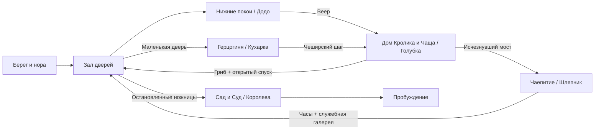

# Alice — Game Design Document

Версия: **0.3**, 31 октября 2026. Язык проекта: русский; идентификаторы в коде: английские.

## 1. Статус документа

Это исходный дизайн игры, а не отчёт о реализованных функциях. Подробный сюжет и характеры ведём в [Story.md](Story.md); системные и технические предложения — здесь. Крупные решения фиксируем в журнале в конце документа. Текущий этап — история на бумаге, техническая разработка приостановлена по решению владельца.

**Утверждено владельцем:** Unity, 2D, платформер-метроидвания с элементами soulslike; жестокая интерпретация «Алисы в Стране чудес»; основная сюжетная ветка близка к первой книге; пять биомов и пять основных боссов; финальный босс — Королева Червей; 4–5 предметов для открытия путей; бэктрекинг; направляющие персонажи; позднее — 5–6 сквозных побочных заданий.

**Уточнения истории:** насилие Алисы вынужденное; мир испорчен Королевой — сознательной тираншей; победа освобождает всю страну; Алиса просыпается у сестры, реальность пережитого остаётся загадкой; неизбежная смерть Голубки нужна как тяжёлый эмоциональный эпизод.

**Уточнения тона:** безопасный, зелёный, солнечный берег резко сменяется мрачным и кровавым кошмаром. Обитатели внешне безобидны и узнаваемы по книге; их жестокость проявляется в поступках. Обычные карточные солдаты могут буднично проводить кровавую казнь. Чудовищные мутации не являются общим художественным направлением.

**Рабочий вариант для проверки:** конкретные четыре способности, Додо / Голубка / Кухарка / Шляпник как первые боссы, устройство мира и суда, оружие, экономика смерти, расположение комнат и параметры боя. Они предложены в этом документе и могут меняться после прототипа.

**Пока не решено:** окончательное название, художественная техника, команда и бюджет, длительность кампании, финальная модель защиты/парирования, коммерческие платформы кроме первоначальной PC-цели.

## 2. Концепция

Алиса следует за Белым Кроликом и оказывается в Стране чудес, испорченной властью Королевы. Чтобы найти выход, она проходит через затопленные покои, разросшийся лес, владения Герцогини, застывшее чаепитие и королевский сад. Познакомившись с обитателями, она решается защитить их. В финале Алиса отвергает неправый суд и побеждает Королеву, освобождая мир.

Тема: **сначала понять правила, затем использовать их, наконец — решиться их отвергнуть**.

Алиса впервые попадает в этот мир. Её биография и причина происходящего не заимствуются из современных игр об Алисе. У жителей есть собственная жизнь. Насилие связано с властью, страхом, телесными превращениями и бессмысленными процедурами. Пробуждение в финале сохраняет возможность сна, не отменяя ценность пережитого.

### Опоры дизайна

1. **Читаемое действие.** Поражение объясняется поведением противника и решением игрока. Анимации и эффекты сохраняют ясность даже в мрачном окружении.
2. **Способность меняет маршрут.** Каждый предмет открывает обязательный путь и минимум два дополнительных применения в ранее посещённых местах.
3. **Книга узнаётся в событиях.** Дом Кролика, Гусеница, младенец-поросёнок, чаепитие, крокет и суд сохраняют сюжетное значение.
4. **Возвращение показывает последствия.** Остановленная гонка, остывшая кухня и закончившееся чаепитие меняют население и доступные пути.
5. **Жестокость имеет причину.** Окружение показывает, кто вводит правила, кто их выполняет и кто платит за их исполнение.

Первоначальная платформа: Windows PC, клавиатура/мышь и геймпад. Полная переназначаемость и поддержка других платформ планируются после проверки основного управления. Цель производительности — стабильные 60 FPS на будущей согласованной минимальной конфигурации; это пока не измеренное обещание.

## 3. Игровой цикл

Исследование комнаты → столкновение или платформенное препятствие → находка/разговор/короткий путь → точка отдыха → освоение новой возможности → босс или сюжетная перемена → возвращение к замеченному ранее проходу.

На коротком отрезке игрок принимает решения о дистанции, атаке и восстановлении. На уровне биома — выбирает маршрут и момент возвращения к отдыху. На уровне кампании — замечает закрытые проходы и связывает их с новыми предметами.

Первая небольшая версия должна доказать качество движения и боя до производства всех биомов. Пять биомов — рамка кампании, а не требование сразу создавать пять больших уровней.

## 4. Алиса и управление

### Базовые действия

- Бег с контролируемым ускорением и торможением.
- Прыжок с переменной высотой, буфером ввода и небольшим допуском после схода с края.
- Падение со сквозных платформ по отдельной комбинации; не со всех поверхностей.
- Базовая атака на земле и в воздухе; короткое комбо без обязательного сложного ввода.
- Наземное уклонение с настраиваемыми кадрами неуязвимости.
- Взаимодействие, лечение, просмотр карты, выбор и применение предмета.

Воздушный рывок не доступен до веера. Двойного прыжка в базовом наборе нет. Карабканье и захват края не входят в первую итерацию: решение зависит от геометрии прототипа.

### Бой — рабочая модель

Предлагаемое основное оружие — длинная швейная игла с собственной формой и анимацией. Это предмет самообороны и точного укола; окончательный дизайн ещё не утверждён. Не переносим узнаваемое оружие из существующих Alice-игр.

Первая проверяемая модель: атака, уклонение, небольшая шкала выносливости на боевые действия. Бег и обычные прыжки не расходуют её, чтобы исследование не превращалось в ожидание. Воздушный рывок ограничен одним зарядом до приземления.

Парирование проверяется отдельным экспериментом. Если оно становится главным действием, пересматриваем выносливость и телеграфы, а не добавляем вторую полноценную защитную систему автоматически.

У каждого врага: читаемая подготовка, активный удар, восстановление; ясная реакция на попадание; заранее выбранные правила прерывания и неуязвимости. Контактный урон применяется только там, где визуально обоснован, а не ко всем телам по умолчанию.

### Здоровье, отдых и смерть

Рабочий вариант: ограниченное число зарядов лечебного флакона; восстановление на точке отдыха. Точка сохраняет прогресс и возрождает обычных врагов. Боссы, предметы, открытые проходы и завершённые сюжетные события сохраняются.

После смерти Алиса возвращается к последней активированной точке. Потеря переносимой валюты с одной попыткой возврата — гипотеза для прототипа, не утверждённое правило. Сюжетные предметы и способности не теряются. Платформенная ошибка сначала проверяется в более мягкой модели: возврат на безопасную поверхность с ограниченным уроном.

Перед каждым боссом доступна точка отдыха и короткий повторный подход без обязательного повторения длинной платформенной секции. Бесконечные попытки, без расходуемого входного билета.

## 5. Предметы и пространственная прогрессия

Четыре постоянных предмета удовлетворяют требованию 4–5. Пятый добавляем только если он открывает отдельный интересный тип маршрута.

| ID | Предмет | Получение | Возможность | Основной затвор |
| --- | --- | --- | --- | --- |
| A01 | Веер Кролика | После Додо, биом 1 | Короткий горизонтальный рывок в воздухе | Разрыв над Залом дверей к дому Кролика |
| A02 | Кусочек гриба | Гусеница, середина биома 2 | Управляемое уменьшение в отмеченных переходах | Маленькая дверь к служебному входу Герцогини |
| A03 | Чеширский шаг | Кот, после Кухарки, биом 3 | Временно проявлять и пересекать специальные исчезнувшие поверхности | Исчезнувший мост к чаепитию в биоме 2 |
| A04 | Часы отсрочки | После Шляпника, биом 4 | Задерживать обозначенные движущиеся механизмы | Ножницы у старого входа в королевский сад, биом 1 |

### Правила предметов

**Веер:** один рывок до устойчивого приземления; не полёт. Базовое уклонение существует отдельно. Дистанцию фиксируем по результатам тестовой полосы препятствий.

**Гриб:** уменьшение в специально отмеченных местах, отдельные малые маршруты; пока без второго масштаба всей игры и полноценного боя в нём. Возврат только при свободном объёме. На каждом обязательном малом маршруте предусмотрен выход; смерть и перезагрузка восстанавливают корректный размер и позицию. Постановочные превращения пролога не выдаются за постоянную способность.

**Чеширский шаг:** работает с авторскими поверхностями, отмеченными когтями и улыбками. Не позволяет проходить через произвольные стены. При завершении эффекта персонаж возвращается на безопасную опору либо получает достаточно времени на выход; исчезновение пола под игроком без предупреждения запрещено.

**Часы:** действуют на заранее отмеченные механизмы. Не меняют глобальное время игры, интерфейс и сохранения. Обязательный переход всегда допускает повторное применение после восстановления ресурса. Применение к обычным врагам рассматривается отдельно от перемещения.

### Дополнительные применения при возвращении

| Предмет | Раннее место, которое замечает игрок | Награда/результат |
| --- | --- | --- |
| Веер | Верхние балки Зала дверей; дальний берег Моря слёз | Основной выход; необязательный запас ресурса |
| Гриб | Решётка Мыши в биоме 1; подвал дома Кролика в биоме 2 | Разговор/будущий квест; короткая дорога |
| Шаг | Разорванная галерея Герцогини; исчезнувшая лестница Зала дверей | Тайник и история дома; выход к верхним дверям |
| Часы | Сушильные валы в биоме 1; пресс на кухне в биоме 3 | Старый маршрут с новыми ответвлениями; улучшение |

Ни один дополнительный проход не обязателен для возврата потерянной валюты до получения нужной способности.

## 6. Карта кампании и затворы

Основная цепочка:

`Пролог → Нижние покои → Додо / A01 → Дом Кролика → Гусеница / A02 → Голубка → Зал дверей → Герцогиня → Кухарка / A03 → возврат в Чащу → Чаепитие → Шляпник / A04 → возврат в Нижние покои → Червонный сад → Суд → Королева → Эпилог`.

Зал дверей — центральный географический узел. Сначала доступен нижний ярус, затем верхние балки, малые проходы и служебная галерея. Открытые изнутри двери остаются открытыми.

| Переход | Условие | Защита от обхода основной цепочки |
| --- | --- | --- |
| Биом 1 → 2 | Веер | Разрыв за пределом обычного прыжка; награда Додо находится за ареной |
| Биом 2 → 3 | Гриб и завершение встречи с Голубкой | Спуск из верхнего леса закрыт гнездом; после боя открывается постоянный короткий путь к узлу |
| Биом 3 → 4 | Чеширский шаг | Мост в Чаще существует только на специальных поверхностях |
| Биом 4 → 5 | Часы и план служебной галереи Шляпника | Механический проход в биоме 1; приглашение объясняет прежний путь к Герцогине, но не является универсальным ключом |
| Сад → Суд | Эпизод крокета, встреча с Грифоном и Квази | Кролик объявляет заседание, открывается проход в зал |

Получение гриба до Голубки намеренно: игрок тренирует способность перед боссом. Арена не требует боя в малом размере. Победа открывает физический спуск, поэтому ранний гриб сам по себе не позволяет пропустить босса.

Приглашение Герцогини именное. Служебный путь обходит внешнюю стражу; в саду Алиса встречает садовников и процессию, затем Королева сама велит ей присоединиться к игре. Приглашение не даёт права на свободный проход и не делает Алису сопровождающей арестованной хозяйки.

Обязательное возвращение ведёт к новому участку старого биома. После босса открывается петля или лифт; повторять весь пройденный уровень не требуется. Быстрое перемещение между точками отдыха рассматриваем после биома 3; обязательный маршрут сначала проектируется проходимым пешком.

## 7. Основной сюжет

Подробная актуальная история вынесена в [Story.md](Story.md), версия 0.3. Это источник событий и характеров; настоящая краткая сводка не заменяет синопсис. Предыдущая версия с заранее выписанной повесткой и раной после пробуждения снята с рассмотрения.

Королева Червей сознательно испортила страну ради власти. Скреплённые волшебной печатью приказы удерживают места и жителей в бесконечных занятиях. Алиса сначала ищет дорогу домой, затем понимает связь между местными бедами и решается защитить тех, с кем познакомилась.

| Часть | Событие и цель | Столкновение и последствие |
| --- | --- | --- |
| Пролог | Сестра, Кролик, падение, маленькая дверь в сад | Неконтролируемые превращения и Море слёз |
| B01. Нижние покои | Мышь; Бег по кругу; попытка вывести участников из машины | Додо выживает, гонка остановлена; найден веер |
| B02. Разросшаяся чаща | Дом Кролика, Билль, Щенок, Гусеница и гриб; дорога через гнездо | Голубка неизбежно погибает, защищаясь и не давая уйти Алисе; открывается спуск |
| B03. Владения Герцогини | Приглашение, ребёнок-поросёнок, арест; клетки и поставки для кухни | Кухарка погибает при нападении на Алису; кухня остановлена, Кот обучает Шагу |
| B04. Чаепитие | Закольцованный стол; Шляпник покупает отсрочку чужим временем | Шляпник выживает, петля прекращается; часы открывают служебный путь в сад |
| B05. Сад и Суд | Садовники, крокет, голова Кота, Грифон и Квази; суд над Валетом | Алиса отказывается от лжесвидетельства; Королева пытается казнить её, погибает в бою; исходная печать разбита |
| Развязка и эпилог | Показано освобождение всей страны; последствия не отменяются | Алиса просыпается у сестры; был ли это только сон, остаётся неясным |

Вынужденное насилие определяет все обязательные бои. Алиса прекращает нападение, когда угроза закончилась. Смерть Голубки как тяжёлый эмоциональный эпизод согласована с владельцем. Остальные конкретные исходы и волшебная печать — рабочие решения подробной истории; окончательная постановка ещё обсуждается.

Поведение персонажей не исправляется автоматически после победы: снимается королевское принуждение. Погибшие не воскресают. Побочные линии не требуются для основного освобождения мира.

Альтернативные концовки, тайный шестой обязательный босс и моральная шкала сейчас не предусмотрены. Продолжение исследования после финала возможно из явно обозначенного сохранения перед судом.

## 8. Направляющие персонажи

| Персонаж | Функция | Что сообщает | Повторная встреча |
| --- | --- | --- | --- |
| Белый Кролик | Сквозная цель и проводник к суду | Срочность, двор, приглашения | Дом, служебные переходы, объявление суда |
| Мышь | Первая ориентация и недоверие | Берег, опасности воды | Убежище в Нижних покоях |
| Додо | Олицетворение процедуры | Условия прохода через берег | После остановки гонки |
| Гусеница | Учитель способности и вопрос идентичности | Гриб и малые проходы | Доступна после открытия спуска |
| Чеширский Кот | Подсказки о связях мира | Герцогиня, Шаг, Шляпник | Чаща, особняк, крокет |
| Герцогиня | Вход в придворный конфликт | Приглашение, положение Королевы | Сад под надзором |
| Соня | Косвенная подсказка | Скрытый механизм времени | После завершения чаепития |
| Грифон и Квази | Передышка и память о стране | Путь к суду, школьное прошлое | Зверинец до финала |

Подсказки имеют три слоя: образная первая реплика, более конкретное повторное уточнение, запись в журнале. Журнал фиксирует намерение Алисы и ориентир, не раскрывая всю карту. Обязательная информация не теряется после одного разговора.

## 9. Обычные враги

Стартовый бюджет кампании: **10 базовых архетипов**, вариации сначала делаем через параметры и композицию встреч. Это оценка объёма, а не уже созданный контент.

| ID | Архетип | Биом | Поведение и назначение |
| --- | --- | --- | --- |
| EN01 | Промокший лакей | 1 | Медленный выпад, обучает окну после удара |
| EN02 | Сборщик на трассе | 1 | Толчок и короткая погоня; учит сохранять пространство |
| EN03 | Садовый паразит | 2 | Низкий прыжок по видимой дуге, учит работать с вертикалью |
| EN04 | Сторожевая птица | 2 | Подготовленное пикирование с посадкой и уязвимостью |
| EN05 | Корневая ловушка | 2 | Стационарная хватка, заранее видимая зона срабатывания |
| EN06 | Перечный слуга | 3 | Ближний бой и ограниченное облако, учит выходить из зоны |
| EN07 | Кухонный метатель | 3 | Снаряд по прямой, уязвимость во время подготовки |
| EN08 | Заводной официант | 4 | Повторяемая серия с паузой; изменяется механизмом комнаты |
| EN09 | Карточный страж | 3, 5 | Щит и тяжёлый выпад, обход после промаха |
| EN10 | Карточный глашатай | 5 | Усиливает строй; приоритетная цель, эффект явно показан |

Мухи, вода, пар, лезвия, ожившая утварь и часы в первой реализации — опасности окружения или варианты этих архетипов, а не скрытое расширение списка полноценных врагов.

Новые враги сначала представляются по одному на безопасной геометрии. Смешанные группы появляются после освоения поведения. В узком проходе не совмещаем обязательный точный прыжок с невидимой дальней атакой.

## 10. Улучшения, карта и сохранения

Рабочая экономика: одна валюта обычных боёв и отдельные уникальные находки. Постоянные улучшения здоровья, лечения и оружия ограничены; числа определяем после первого босса. Новые пространственные способности не покупаются за фарм.

Карта открывается по комнатам, показывает соединения, точки отдыха, замеченные затворы и отметки игрока. Тип затвора обозначен формой и символом, не только цветом. Секретная комната не раскрывается до обнаружения.

Минимальное состояние сохранения: версия схемы; ID точки отдыха; здоровье/заряды при восстановлении; полученные A01–A04; флаги боссов; постоянные двери и лифты; уникальные находки; состояния NPC/диалогов; раскрытая карта; будущие квестовые флаги. Используем устойчивые ID, не имена объектов или их позиции в списке.

Запись атомарная через временный файл и замену, с резервной копией. Ошибка загрузки не перезаписывает исходное сохранение. Хранение через `Application.persistentDataPath`, вне репозитория. Точки автосохранения: отдых, получение способности, победа над боссом, важный постоянный затвор. Смерть не должна отменять уже записанную способность.

## 11. Побочные задания — зарезервированный объём

План: 5–6 сквозных линий, разработка после фиксации основной цепочки. Их полный сюжет сейчас не утверждён. Возможные участники: Мышь, Билль, освобождённые участники гонки, поросёнок, Соня, карточные садовники.

Каждая линия должна соединять минимум два биома, изменять встречу или окружение и иметь понятную запись текущего состояния. Побочные задания не дают обязательные A01–A04 и не блокируют основную концовку. Не вводим необратимый провал за незаметное пересечение границы комнаты. Точки невозврата обозначаем заранее.

## 12. Визуальное и звуковое направление

2D вид сбоку, ортографическая камера, многослойные планы и свет URP 2D. Выбор между рисованной анимацией, скелетной 2D-анимацией и пиксель-артом остаётся открытым. Pixel Perfect и единицы спрайтов фиксируем только после выбора техники.

Обитатели сохраняют безобидные книжные силуэты. Карта остаётся обычной картой с руками и ногами, Кролик — белым кроликом в жилете, Шляпник — человеком в шляпе. Монструозная анатомия и превращение босса в огромного мутанта не используются как стандартное повышение угрозы. Конкретные дизайны создаём самостоятельно по первоисточнику.

Окружение мрачно; кровь, тела и следы казней показаны прямо. Жестокость часто выполняется буднично, при неизменной внешности и спокойном разговоре. Важна реакция Алисы на то, что остальные считают нормальным. Повествовательный ориентир: обычные карточные солдаты казнят пленного и продолжают обсуждать службу. Солнечное зелёное спокойствие полноценно принадлежит сценам у сестры; передышки внутри страны сохраняют тревогу.

Алиса, враги и интерактивные поверхности читаются на фоне. Кровь, пыль и постобработка не скрывают края платформ. Визуальная логика биомов связана с их занятиями: сушить, выращивать, готовить, обслуживать, судить.

Музыка и звуки собственные или с проверенной лицензией. Повторяющиеся мотивы меняются после победы над боссом. Звуковые сигналы механик дублируются визуально. Важные реплики имеют субтитры.

Доступность: размер текста, переназначение ввода, настройка тряски и вспышек, раздельная громкость, возможность удержания вместо частых нажатий. Сложность и помощь в таймингах обсуждаются после прототипа; отсутствие таких функций не объявляем частью художественной идеи заранее.

## 13. Технические принципы

Unity 6000.6.6f1, URP 2D, Input System. `Assets/_Alice` — собственный контент. Сцены создаются через Editor API; GUID и `.meta` хранятся в Git. Технические детали описаны в [TechnicalSetup.md](TechnicalSetup.md).

Первоначально: одна сцена проверки движения, затем отдельный малый вертикальный срез. Потоковую загрузку всей карты, сложную архитектуру сервисов и собственные инструменты диалогов не строим до необходимости. Параметры действий и врагов выносим в данные по мере появления второго реального использования.

В коде разделяем движение, боевую реакцию, постоянные способности, состояние мира, диалоги и сохранения. Предметы открываются по ID, а не наличию конкретного объекта в сцене. Время отсрочки применяется к интерфейсу механизма, а не через глобальный `Time.timeScale`.

## 14. Риски и решения до полного производства

| Риск | Что проверяем | Ограничение первой версии |
| --- | --- | --- |
| Размер Алисы умножает объём уровней | Камера, коллизии, выход из малых проходов | Малые маршруты только в отмеченных переходах |
| Четыре способности перегружают ввод | Геймпад и переключение в опасности | Веер на отдельном контекстном действии; сложные комбинации не требуются |
| Книга линейна, карта требует петель | Понятность целей после каждого босса | Центральный узел и четыре проверяемых затвора |
| Пять уникальных боссов дороги | Полноценный Додо до других четырёх | 2 фазы обычно, 3 только у Королевы |
| Мрачные эффекты мешают платформеру | Читаемость без звука и на тёмном экране | Отдельный проход визуальной проверки телеграфов |
| Сходство с современной Alice-адаптацией | Оружие, дизайн, история и материалы | Собственные добавления и реестр источников |
| Катсцены тормозят производство | Ценность эпизода и время реализации | Игровые сцены/иллюстрированные вставки вместо сложной кинопостановки |

## 15. Критерии готовности дизайна к производству

- Утверждены базовый бой, роль парирования и стоимость действий.
- На тестовом маршруте доказаны четыре разных типа пространственных затворов.
- Нет обязательного прыжка, зависящего от случайной частоты кадров.
- Смерть, загрузка и возврат не оставляют Алису за закрытым затвором или в неверном размере.
- Первый биом с Додо пройден от входа до возврата в узел.
- У каждой новой способности есть безопасное обучение и последующее применение.
- Есть оценка времени производства одного врага, комнаты и босса.
- Подтверждены визуальная техника, целевой объём кампании и минимальные системные требования.

## 16. Журнал решений

| Дата | Решение | Статус |
| --- | --- | --- |
| 2026-10-31 | Unity, 2D; пять биомов/боссов; Королева — финал; сюжет близок к книге | Утверждено владельцем |
| 2026-10-31 | Четыре предмета: веер, гриб, Шаг, часы | Рабочая версия |
| 2026-10-31 | Додо, Голубка, Кухарка, Шляпник — первые четыре босса | Рабочая версия |
| 2026-10-31 | Одна концовка и отложенные 5–6 сайдквестов | Рамка первой версии |
| 2026-10-31 | PC-прототип, URP 2D, единый репозиторий | Технический старт |
| 2026-10-31 | Техническую разработку приостановить; сначала цельная история | Решение владельца |
| 2026-10-31 | Вынужденное насилие; Королева сознательно испортила мир; победа освобождает страну | Утверждено владельцем |
| 2026-10-31 | Пробуждение у сестры; реальность мира остаётся загадкой | Утверждено владельцем |
| 2026-10-31 | Неизбежная смерть Голубки как эмоционально тяжёлый эпизод | Утверждено владельцем |
| 2026-10-31 | Подробный синопсис вести в Story.md; старую ветку с повесткой до падения убрать | Редакция 0.2 |
| 2026-10-31 | После солнечного берега — кровавый мрачный кошмар; безобидная внешность обитателей и ужасные поступки | Утверждено владельцем, редакция 0.3 |
