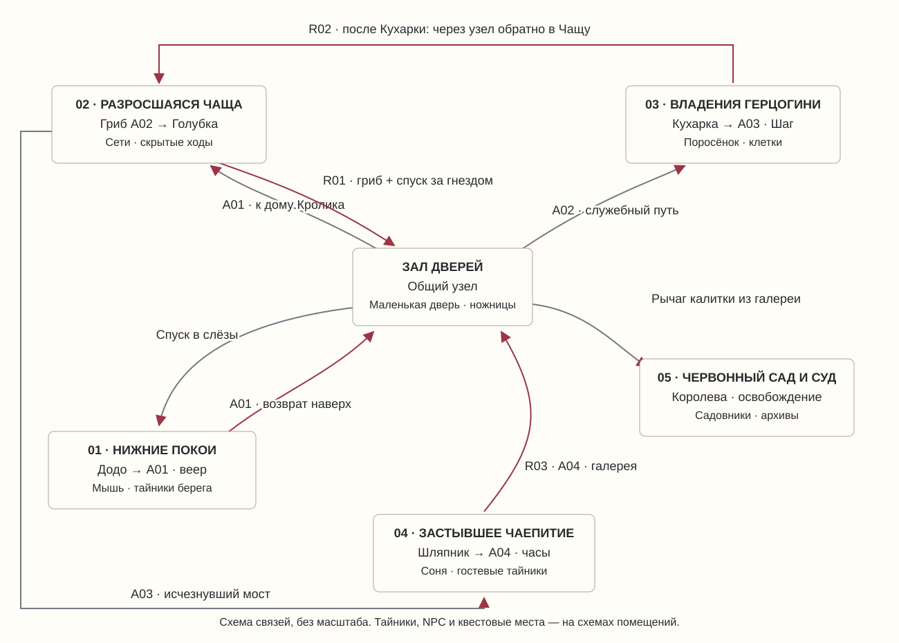
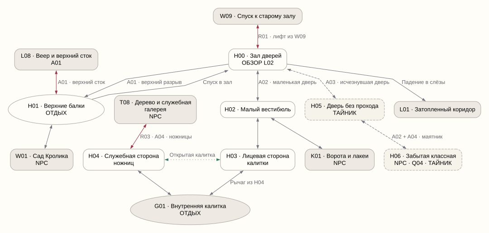
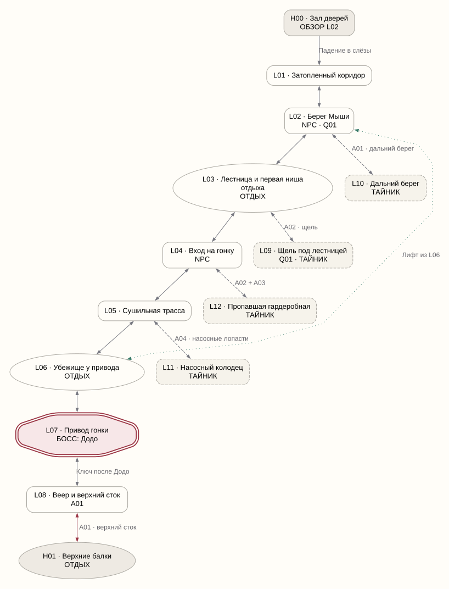
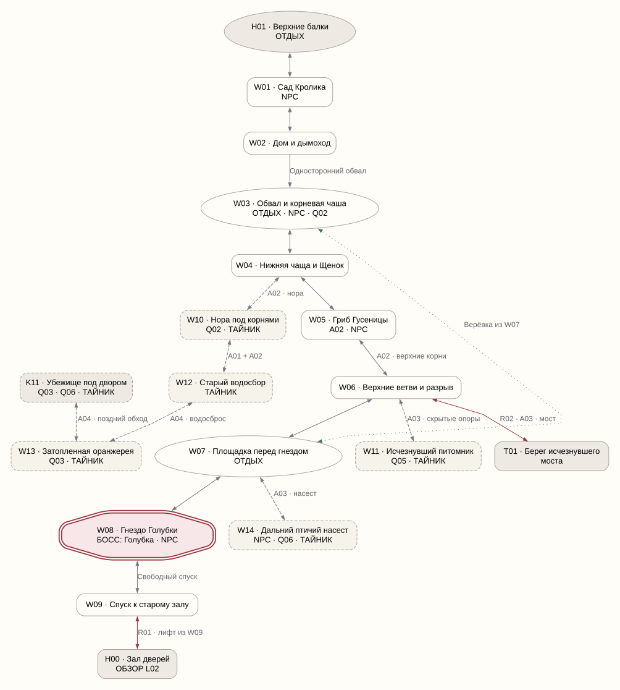
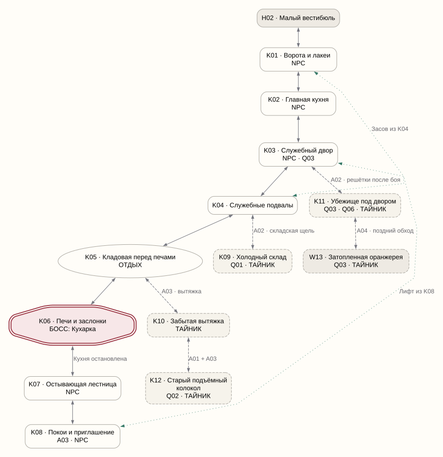
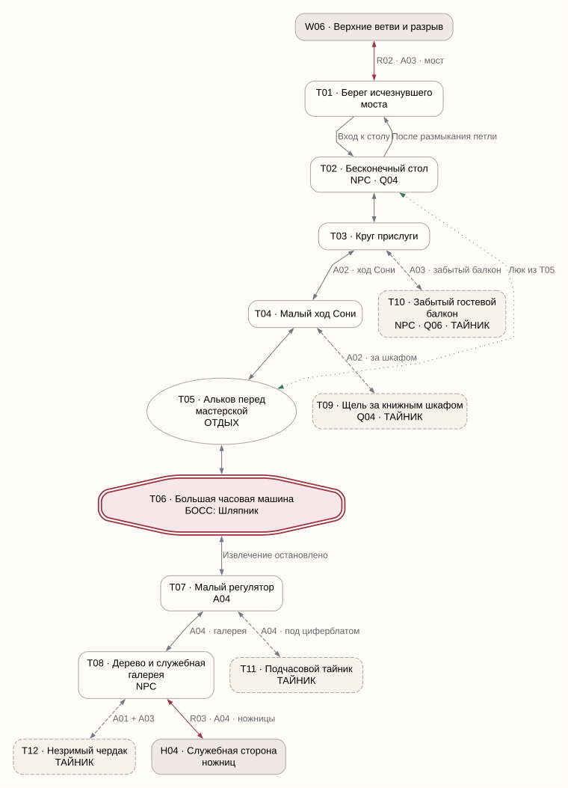
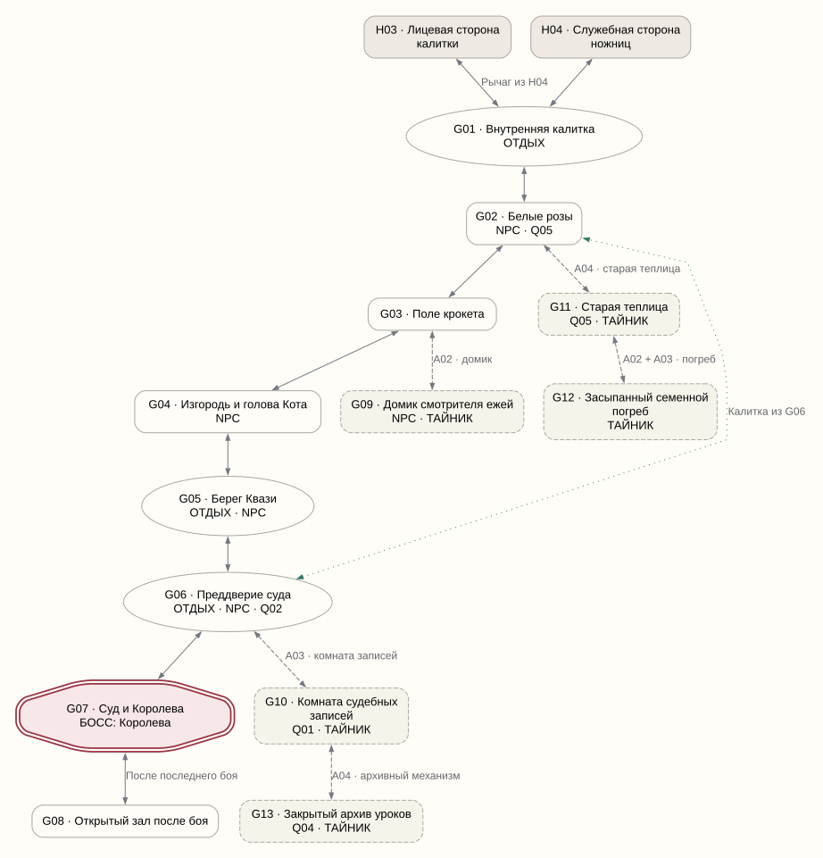

# Карта мира и помещений

Этап 3 из 7 · версия 0.12 · 1 ноября 2026.

Первая схема пространственного устройства кампании: **70 узлов помещений, 24 из них необязательные**, пять биомов и общий Зал дверей. Это рабочие помещения и группы экранов, а не утверждённая смета готовых уровней. Схемы показывают проходы и ограничения; расстояния прыжков и масштаб ещё не заданы.

## 1. Общая карта

Сначала путь уводит в Нижние покои, затем возвращает через верх Зала к дому Кролика. После Голубки открывается спуск к маленькой двери и Герцогине. Из особняка нужно вернуться в Чащу к исчезнувшему мосту. После Шляпника служебная галерея приводит к обратной стороне ножниц и открывает сад.

Боковые области не занимают место обязательных биомов. Они содержат находки, NPC и места для будущих квестов. Основную концовку можно получить без их посещения.

### Обозначения

- Прямоугольник — помещение или компактная группа экранов; ID используется для привязки эпизодов.
- Двойная рамка и слово **БОСС** — основное столкновение. Облик фигуры на схеме не задаёт внешность персонажа.
- Овал и **ОТДЫХ** — кандидат на точку восстановления; её художественный вид определим позже.
- Пунктирная рамка и **ТАЙНИК** — необязательный узел. Затемнённый узел на краю схемы — переход в другую область.
- **NPC** — встреча; подробности и эпизоды доступны также в подсказке при наведении. **Q01–Q06** — места будущих побочных линий.
- Стрелка показывает разрешённое направление. Обычный проход с двумя стрелками обратим; падение из дома — нет.
- Бордовый путь — возвращение между областями. Зелёный точечный — постоянный короткий путь, который открывается с дальней стороны. Пунктирный — боковой маршрут.
- A01 — веер; A02 — гриб; A03 — Чеширский шаг; A04 — часы. Все способности остаются у Алисы.

Слова «после босса» означают конкретное физическое изменение: полученный ключ, остановку печей, размыкание петли или освобождённый проход. Невидимой проверки номера главы нет.

## 2. Зал дверей — общий узел

**Основные места:** H00 — зал с ключом и бутылочкой; H01 — верхние балки; H02 — подход за маленькой дверью; H03 — лицевая сторона закрытой садовой калитки; H04 — служебная сторона ножниц.

Из H00 в H01 можно подняться после веера. Для H02 нужны гриб и золотой ключ. Из H02 сразу доступен путь к Герцогине, но перед садом остаётся закрытая калитка. В H04 сначала попадают из галереи Шляпника, задержав ножницы часами. Рычаг в H04 открывает калитку и короткую связь с H03. Поэтому видимый раньше сад нельзя пройти, просто снова уменьшившись.

На площадке, где лифт W09 выходит в H00, находится зарешеченное смотровое окно. При R01 через него виден берег L02 и остановленная гонка. На схеме H00 это обозначено как **ОБЗОР L02**. Помещения не соединены новым проходом: окно находится вне доступного проёма, движение игрока остаётся W09 → H00 → H02. Сам H04 и служебные ножницы относятся к общему узлу H, а не к биому L.

**Скрытая область «Забытая школа»:** H05 проявляется Шагом, а путь в H06 требует малого роста и задержки маятника. Здесь предусмотрены необязательная учебная история, предмет линии Сони и место для нового второстепенного NPC. Его личность и диалог пока не написаны. Ни одного обязательного предмета или единственной подсказки к главному выходу здесь нет.

Обрывок ярлыка в E01 не является тайником H00. Его видит только отдельный постановочный ракурс за столиком. Бумага остаётся за сплошным каменным цоколем фонового слоя: обычная камера не показывает её при E07, R01 и R03. Цоколь не оформляется как разрушаемая стенка, щель для A02 или поверхность A03. Нет блеска, метки, подсказки взаимодействия или записи о пропущенном предмете. Предмет не исчезает за кадром и не создаёт дополнительной загадки до финала.

## 3. Нижние покои

**Основной ход:** H00 → L01 → L02 → L03 → L04 → L05 → L06 → L07 → L08 → H01. Он покрывает E03–E07. L07 — Додо, L08 — веер. Мышь находится на берегу L02; перед Додо есть убежище L06.

Первый отдых расположен в защищённой нише L03, за первым столкновением. Выход из ниши снова показывает того же враждебного лакея на прежнем месте. Берег Мыши L02 до этого не даёт возможности отдохнуть: знакомство с восстановлением обычных врагов должно произойти после победы над одним из них.

Из L06 открывается лифт к L02: перед повторной попыткой не нужно заново проходить всю трассу. После победы верхний сток выводит к Залу дверей. В L02 можно вернуться ради разговоров, находок и последствий остановленной гонки. Обычные враждебные группы при этом продолжают возвращаться после отдыха.

| Боковое место | Как попасть | Что зарезервировано |
| --- | --- | --- |
| L09, щель под лестницей | A02 после Чащи | Именные жетоны для линии Мыши |
| L10, дальний берег | A01; виден до получения веера | Находка для будущего улучшения лечения |
| L11, насосный колодец | A04 после чаепития | Редкая находка и следы прежнего наводнения |
| L12, пропавшая гардеробная | A02 + A03 | Тайник снаряжения; точный эффект определим на этапе систем |

Возвращение даёт и сюжетную перемену: выжившие больше не бегут, Додо не командует. Предмет Q01 дополняет имена погибших, а не заменяет обязательную книгу, которую забирает Мышь.

## 4. Разросшаяся чаща

**Основной ход:** H01 → W01 → W02 → W03 → W04 → W05 → W06 → W07 → W08 → W09 → H00. W02 — дом, W03 — место встречи с пострадавшим Биллем, W05 — Гусеница и гриб, W08 — Голубка. Эпизоды E08–E14 и R01.

Падение W02 → W03 одностороннее: разрушенный подвал не позволяет подняться обратно, в том числе после получения гриба. Это постоянный обвал, он не восстанавливается после отдыха и не становится коротким путём. Нижняя Чаща имеет несколько боковых ходов, но другой выход к узлу лежит за гнездом. Дополнительный малый маршрут для A02 — нора W10, а не подвал дома. Ранний гриб не даёт покинуть область в обход Голубки.

В W07 находится точка отдыха и спускается верёвка в W03. Так можно вернуться к Биллю и убежищу, не повторяя верхние ветви. Из W09 открывается лифт в H00; он остаётся постоянной связью после первого спуска. Само гнездо и его потеря не сбрасываются.

| Боковое место | Как попасть | Что зарезервировано |
| --- | --- | --- |
| W10, нора под корнями | A02; в стороне от обучения у Гусеницы | Инструмент Билля и вход к старому водосбору |
| W11, исчезнувший питомник | A03 после Герцогини | Белые семена; квест садовников начнётся позднее, находку можно взять заранее |
| W12–W13, затопленные ходы | A01 + A02 до водосбора; A04 дальше | Двухузловая скрытая область, укрытие и поздняя связь с особняком |
| W14, дальний насест | A03 | Необязательная лесная птица, начало линии о пленниках |

Из W06 после Шага открывается мост к T01. Этот путь замечают ещё при первом подъёме, но на тот момент нужной способности нет. Переход W13 ↔ K11 требует часов с обеих сторон: скрытая связь не позволяет обойти Кухарку до получения A03.

## 5. Владения Герцогини

**Основной ход:** H02 → K01 → K02 → K03 → K04 → K05 → K06 → K07 → K08. Здесь проходят E15–E21. K01 — лакеи и казнь, K02 — Герцогиня с младенцем, K03 — превращение и арест, K06 — Кухарка, K08 — приглашение и обучение у Кота.

Птица, которую Кухарка держит на столе в K02, не погибает за кадром: в E16 её убирают живой в запертую клетку у лестницы K07. После боя доступны кухонные ключи; в E21 Алиса открывает эту клетку и видит, как птица покидает кухню по безопасному проходу. Это постоянная ключевая сцена. Она не требует заходить в необязательный K11 и не зависит от линии Q06; у этих мест остаются собственные необязательные находки.

K05 — кандидат на точку отдыха перед окончательным запиранием кухни. Переход в бой и постоянные засовы отделены от безопасного возвращения на предыдущем участке. Сцена K06 закрывает доступный ранее малый выход сплошной заслонкой; способность уменьшаться не превращается в прохождение через металл.

Засов из K04 открывает служебную связь с K01. Лифт из K08 ведёт обратно в K03 после остановки кухни, сокращая возвращение к Чаще через H02 и H00. До победы этот лифт нельзя вызвать с нижней стороны.

| Боковое место | Как попасть | Что зарезервировано |
| --- | --- | --- |
| K09, холодный склад | A02 | Отдельная ведомость для линии Мыши |
| K10, забытая вытяжка | A03 после обучения Кота | Скрытый верхний маршрут |
| K11, убежище под двором | A02, после открытия решёток по окончании боя | Встреча с поросёнком, след птиц, будущая связь с W13 через A04 |
| K12, старый подъёмный колокол | Через K10, A01 + A03 | Деталь для помощи Биллю |

K11 — не проход, которым можно уклониться от обязательного нападения Кухарки. После сцены запирания решётки остаются закрыты, пока печи и её управление не остановлены. Привязка тайника к этому физическому состоянию нужна и в сером прототипе.

## 6. Застывшее чаепитие

**Основной ход:** W06 → T01 → T02 → T03 → T04 → T05 → T06 → T07 → T08 → H04. Эпизоды E22–E28 и R03. T02 — гости за столом, T04 — малый ход Сони, T06 — машина и бой, T07 — часы, T08 — дерево с Кроликом и служебная галерея.

Вход T01 → T02 возможен сразу после моста. Обратный выход из-за стола возвращает к началу, пока работает машина Шляпника: на схеме возврат T02 → T01 открывается только после её остановки. Это локальное свойство устройства, а не магия Королевы. Шаг не отменяет его.

T05 — точка отдыха перед мастерской. Из неё открывается люк к T02, позволяющий вернуться к Соне и не повторять малый ход. Он не выпускает из общей петли до победы. После T06 оба обычных выхода работают, а путь T08 → H04 требует часов из T07.

| Боковое место | Как попасть | Что зарезервировано |
| --- | --- | --- |
| T09, щель за шкафом | A02 и внимательный осмотр служебного хода | Страница истории Сони |
| T10, забытый гостевой балкон | A03 | Птица-гость и сведения о пленниках; дополнительная линия Q06 |
| T11, подчасовой тайник | A04 после победы | Находка для улучшения лечения |
| T12, незримый чердак | A01 + A03 из галереи | Редкая находка и история прежнего гостя |

Ключ мастерской, часы и показание Шляпника не зависят от поисков страниц. Малый регулятор не питается найденными пленниками и не расходует их жизнь при использовании.

## 7. Червонный сад и Суд

**Основной ход:** H03/H04 → G01 → G02 → G03 → G04 → G05 → G06 → G07 → G08. Эпизоды E29–E38. Пробуждение E39 происходит вне игровой карты, в солнечном саду рядом с сестрой.

G02 — спасение садовников, G03 — крокет, G04 — спор о голове Кота, G05 — Грифон и Квази. Только после этого маршрут ведёт в преддверие суда G06. Из G06 открывается калитка к розам: вернуться к боковым местам можно без повторения всей церемонии.

G06 — основная точка отдыха перед финалом. Суд, построения и личный бой с Королевой происходят в одном комплексе G07; это один босс. Повторная попытка не требует заново проходить крокет и смотреть весь суд. G08 — пространство для речи и начала освобождения, не новый боевой уровень.

| Боковое место | Как попасть | Что зарезервировано |
| --- | --- | --- |
| G09, домик смотрителя ежей | A02 с поля | Место второстепенного NPC и необязательной находки |
| G10, судебные записи | A03 из преддверия | Завершение поиска имён для Мыши |
| G11–G12, белая теплица | A04 до теплицы, A02 + A03 до погреба | Отдельное скрытое ответвление, место семян и редкая находка |
| G13, архив уроков | A04 через G10 | Место завершения истории Сони |

На этом этапе все четыре способности уже получены. Поиск всё ещё требует наблюдательности и их сочетания. Все эти места доступны до финального боя, а не за титрами или дополнительной концовкой.

## 8. Места для шести побочных линий

Названия, предметы и предполагаемые развязки ниже — **резерв этапа 6**, не готовые квесты. Сейчас важно сохранить место на карте и связи нескольких областей. Награды и полные диалоги ещё не написаны.

| Линия | Встреча | Поиск | Повторная встреча или итог | Ограничение |
| --- | --- | --- | --- | --- |
| Q01 · Имена выбывших | Мышь, L02 | Жетоны L09, отдельная ведомость K09 | Записи G10; ответ Мыши при возвращении | Не подменяет обязательную книгу Додо |
| Q02 · Дом после Алисы | Билль, W03 | Инструмент W10, деталь K12 | Билль в G06 | Его участие в суде не зависит от ремонта |
| Q03 · Тропа из двора | Поросёнок, K03 | Убежище K11 и путь к W13 | Укрытие в W13 | Опоздание не убивает спасённого автоматически |
| Q04 · Незаконченная история | Соня, T02 | Страница T09 и фрагмент H06 | Архив G13; затем Соня | Не прячет единственную подсказку к мастерской |
| Q05 · Белые семена | Садовники, G02 | Возвращение в питомник W11 | Белая теплица G11 | Не требуется для освобождения страны |
| Q06 · Разрезанная сеть | Лесная птица, W14 | След клеток K11, птица-гость T10 | Насест W14 и освобождённые | Не воскрешает Голубку и не блокирует яйцо |

Раннюю находку сохраняем, даже если Алиса ещё не встретила нужного NPC. Персонаж может узнать её позже. Физическое исчезновение предмета из-за смены главы и провал за незаметное пересечение двери не заложены.

## 9. Что сохраняется при возвращении

Лифты L06–L02, W09–H00 и K08–K03, верёвка W07–W03, люк T05–T02 и калитка G06–G02 открываются с дальней стороны и больше не требуют повторного действия. K04 также снимает служебный засов к K01.

Маленькая дверь открывается золотым ключом один раз. Проход в сад дополнительно зависит от обычного рычага H04: ключ и уменьшение не открывают его сами. После рычага лицевая и служебная стороны соединены.

Постоянные способности, смерти именованных боссов, окончание гонки, выключение часовой петли, открытые клетки и собранные уникальные находки не сбрасываются при смерти или отдыхе. Прогресс NPC, квестов, открытых дверей и рычагов также сохраняется.

Обычные враги после отдыха снова находятся на своих исходных местах, получают полное здоровье и прежнее враждебное поведение. Повторная победа снова даёт валюту. Циклы повторяемых угроз восстанавливаются; постоянное выключение гонки, открытие клетки и другие ключевые изменения имеют приоритет над сбросом. Фарм поддерживается, но отдых не восстанавливает босса и не заставляет пересматривать сюжетную сцену.

Места отдыха — пока кандидаты, не точный темп лечения. Перед каждым боссом есть близкий подход: L06 → L07, W07 → W08, K05 → K06, T05 → T06, G06 → G07. Именованные NPC не возвращаются к прежней реплике или положению только из-за отдыха.

Поражение возвращает Алису пробуждением внутри кошмара к последнему активированному месту отдыха. До первой активации L03 используется начальная площадка H00; нового помещения для неё не добавляется. Обычные враги восстанавливаются, а уже совершённые постоянные изменения карты сохраняются. Солнечный сад с сестрой остаётся за пределами повторных возвращений и возникает только в E39.

## 10. Проверка связей

По данным схем выполнена проверка переходов с учётом **текущего положения** Алисы, уже полученных способностей и открытых засовов. Проверка не переносит способность из одного исследованного узла в другой посредством условного телепорта: это важно для одностороннего дома и петли чаепития.

- Основная ветка достигает G08; все 70 узлов в принципе достижимы.
- При запрете завершить любой из пяти боссов до финала добраться нельзя.
- Без любой из A01–A04 основная цепочка не завершается.
- Гриб, взятый до Голубки, не даёт попасть к Герцогине в обход гнезда.
- Сад недоступен без часов и служебного пути к рычагу.
- Удаление всех 24 необязательных узлов оставляет основную ветку проходимой.
- Все необязательные узлы доступны до победы над Королевой.
- Все 44 эпизода привязаны к помещениям либо вынесены во вступление и пробуждение.
- Для всех шести квестовых заготовок есть точки в нескольких областях.

Это проверка логики графа при успешном прохождении обязательных боёв и действий. Она не доказывает, что конкретный прыжок удобен, враг сбалансирован или экран читаем. Эти свойства требуют дальнейшей геометрии и будущего прототипа.

## 11. Источники схем и следующий шаг

Структура хранится в `Maps/WorldMapData.json`, схемы — в соседних SVG. HTML-GDD включает их внутрь себя и продолжает работать без сервера и интернета. Схему можно открыть отдельно для крупного просмотра.

`Build-WorldMaps.cjs` создаёт SVG и отчёт `Maps/Validation.json`. Нужны Node.js и `@viz-js/viz` 3.25.0; путь установленного модуля можно передать через `ALICE_VIZ_MODULE`. Пересборка обычного HTML выполняется прежней PowerShell-командой и не требует повторной генерации схем.

На бумаге следующий шаг — правила движения, боя и ресурсов. После их выбора уточняем формы и относительные размеры комнат; это может изменить соединения, поэтому проверку повторяем. Наполнение врагами и полные побочные квесты будут отдельными этапами. Работа в Unity остаётся на паузе.
